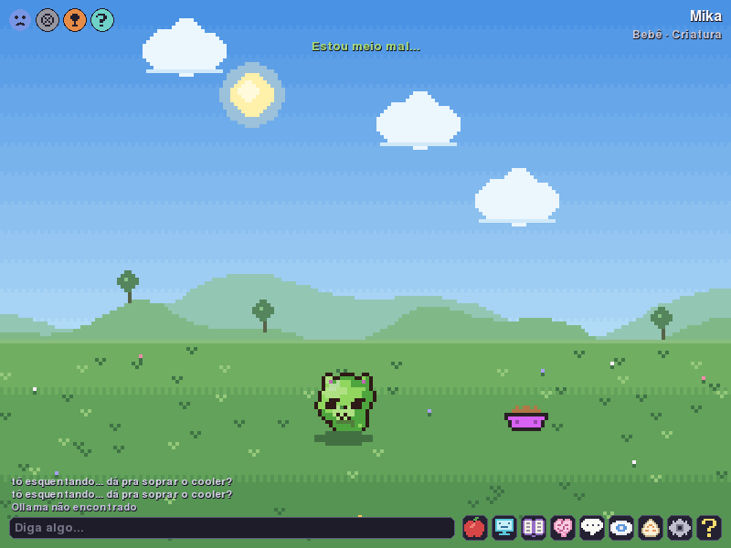
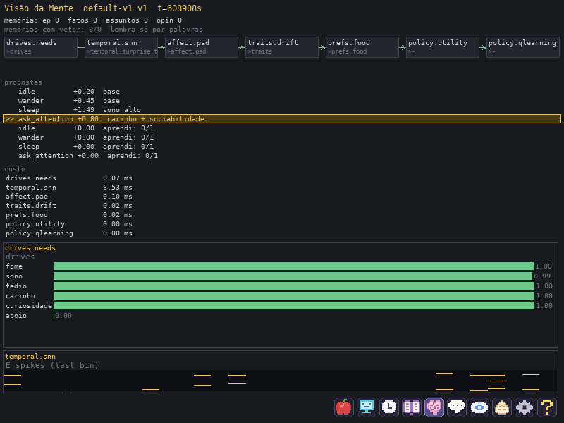
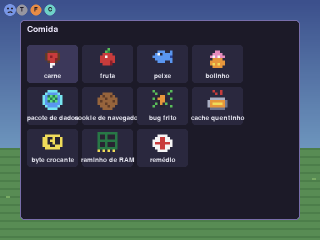
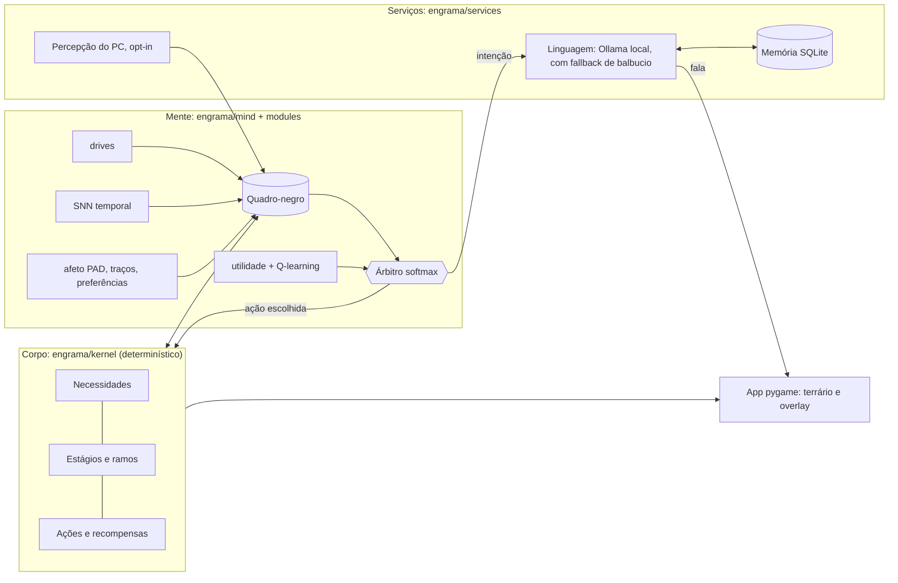
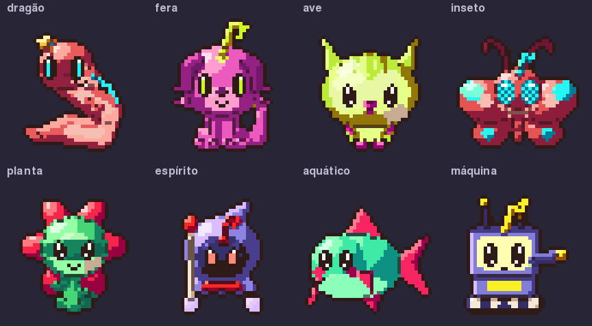
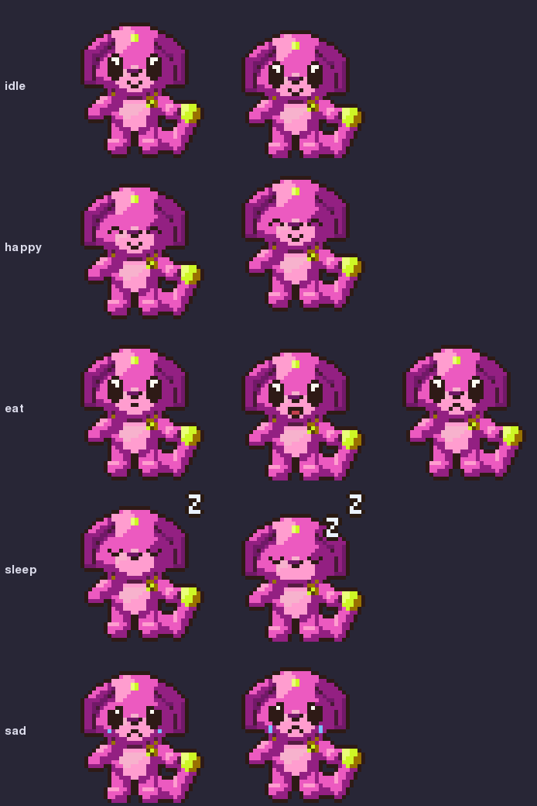
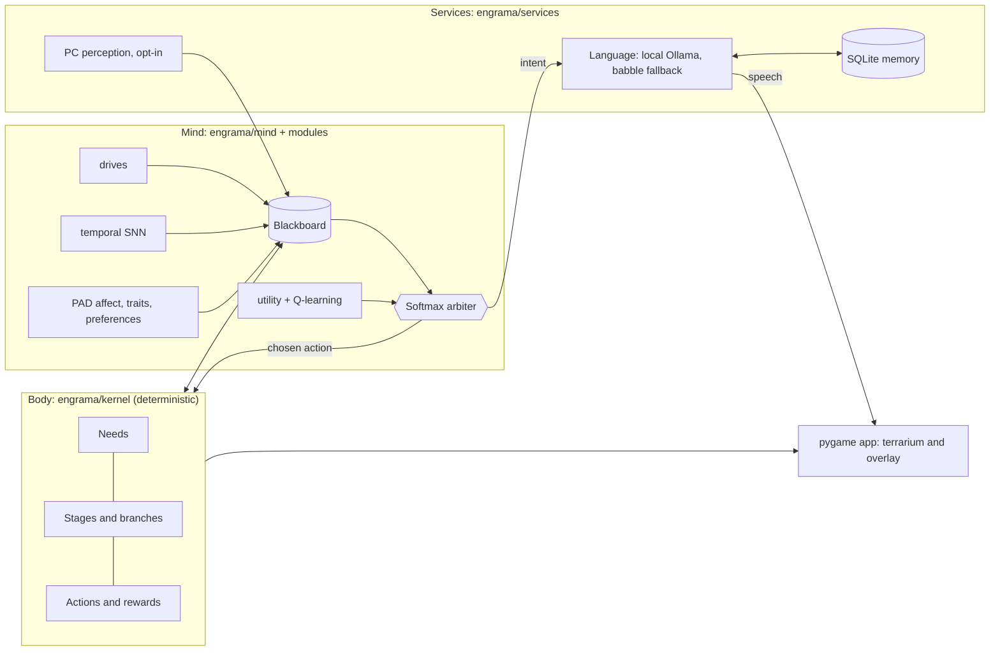

# Engrama

**PT** | [EN](#en)

> Uma criatura digital que vive no seu desktop. Local, offline, com mente de verdade.


[](LICENSE)


<sub>Arte do M11 ([Arte](#arte)): seis linhagens, do ovo à forma final.</sub>

Engrama é um companheiro virtual no estilo tamagotchi/V-Pet que mora no seu computador. Ela nasce de um ovo, tem fome, sono, tédio e carinho, evolui por ramos conforme o jeito como você cuida dela, adoece, envelhece, morre e renasce como um ovo que herda um pouco da vida anterior. Conversa com você por um modelo de linguagem **local** (Ollama), lembra do que você contou, nota (se você deixar) o que você está fazendo no PC e comenta, e pode andar sobre a sua barra de tarefas. **Nada sai da sua máquina.** Funciona no Windows e no Linux.

Por baixo, a "mente" não é só texto de LLM: é uma simulação de verdade (necessidades, afeto, aprendizado por reforço, uma rede de disparos temporal) que escolhe as ações. O LLM só dá voz.

## Em ação

<table>
<tr>
<td width="50%"><br><sub><b>Terrário.</b> A criatura, os indicadores de humor e necessidades (canto) e a caixa de conversa.</sub></td>
<td width="50%"><br><sub><b>Visão da Mente (F2).</b> O grafo da receita, as propostas do tick (a vencedora destacada) e o custo em ms de cada módulo.</sub></td>
</tr>
<tr>
<td><br><sub><b>Comidas (F4).</b> Comidas de verdade, "comidas digitais" de brincadeira e remédio.</sub></td>
<td><br><sub><b>Permissões (F8).</b> Toda percepção do PC começa desligada, fonte por fonte.</sub></td>
</tr>
</table>

<sub>Capturas reais do app, geradas por `tools/screenshots.py` (SDL sem janela, sem LLM). Mais criaturas em [Arte](#arte).</sub>

## Comece em 1 minuto

1. Baixe o pacote da [página de Releases](https://github.com/alexzjss/engrama/releases) (Windows `.zip`, Linux `.tar.gz`), extraia e abra `engrama` (não precisa de Python).
2. Responda à tela de permissões (pode dizer "agora não" para tudo).
3. Um ovo aparece: clique para fazer carinho, **F4** para alimentar, **Enter** para conversar.
4. Opcional: instale o [Ollama](https://ollama.com) e baixe o modelo no **F5** para ela falar de verdade. Sem ele, ela balbucia e continua viva.

Do código-fonte: `pip install -e .[dev]` e `python -m engrama` (detalhes em [Requisitos e instalação](#requisitos-e-instalação)).

## Como funciona por dentro



| Camada | Pacote | Papel | Detalhe técnico |
|---|---|---|---|
| **Corpo** | `engrama/kernel` | Necessidades, estágios, ações, recompensas, genoma | Determinístico: mesma semente, mesmo resultado |
| **Mente** | `engrama/mind`, `engrama/modules` | Módulos trocáveis que propõem ações | Contrato `Module` (`reads`, `writes`, `rate_hz`, `step`, `propose`, `learn`), quadro-negro e árbitro softmax; receitas TOML escolhem módulos e pesos |
| **Voz** | `engrama/services/language` | Transforma intenção em frase | Fila de jobs priorizada (conversa > comentário > reflexão > fatos), nunca levanta exceção para quem chama; **nunca escolhe ações** |
| **Memória** | `engrama/services/memory` | Fatos, assuntos, opiniões, reflexões | SQLite local, tetos fixos, busca por palavras e (opcional) por significado com embeddings |
| **Percepção** | `engrama/services/perception`, `engrama/osapi` | App em foco, ociosidade, tela cheia, carga | Opt-in por fonte, lista de bloqueio, só categoria e tema curto são guardados; backends Windows, X11, Wayland |
| **Laboratório** | `engrama/lab` | Simula semanas em segundos | Perfis de usuário simulados, log de experiência em SQLite, replay, métricas, suíte de comparação de receitas |
| **App** | `engrama/app` | Janela, arte, áudio, i18n PT/EN | pygame-ce, sprites **procedurais** a partir da semente (8 famílias × 3 planos), sobreposição sem borda |

- **Orçamento de recursos:** alvo de 150 MB de RAM e 2% de CPU em regime estável (`tools/bench.py`), com descanso manual e automático (2 FPS, mente em ritmo reduzido, LLM descarregado).
- **Mente de verdade:** a SNN temporal avança em compassos de 60 s de tempo simulado; afeto em três eixos (PAD); Q-learning e utilidade disputam cada tick; a Visão da Mente mostra tudo ao vivo.
- **Regras de dependência** entre camadas são verificadas por `tests/test_architecture.py`; a CI roda ruff e testes em Ubuntu e Windows.

## Sumário

- [Em ação](#em-ação) · [Comece em 1 minuto](#comece-em-1-minuto) · [Como funciona por dentro](#como-funciona-por-dentro)
- [Funcionalidades](#funcionalidades)
- [Privacidade e offline](#privacidade-e-offline)
- [Requisitos e instalação](#requisitos-e-instalação)
- [Primeiro uso](#primeiro-uso)
- [Como usar](#como-usar) (teclas, linha de comando, dados)
- [Linux: o que cada sessão oferece](#linux-o-que-cada-sessão-oferece)
- [Arte](#arte)
- [Para desenvolvedores](#para-desenvolvedores)
- [Estado do MVP e roadmap](#estado-do-mvp-e-roadmap)
- [Licença](#licença)

## Funcionalidades

| Área | O que você tem |
|---|---|
| **Ciclo de vida** | Ovo, bebê, criança, adulto, perfeito, final. A forma em cada estágio depende do cuidado, da personalidade e dos interesses dela (ramos como brincalhão, curioso, companheiro, sábio, lendário...). Evolução visível, com animação. |
| **Necessidades e cuidado** | Fome, sono, tédio, carinho, curiosidade e apoio emocional. Você alimenta (comidas de verdade e "comidas digitais"), faz carinho, conversa, dá remédio. Negligência pesa; atenção também aparece nos traços dela. |
| **Doença, velhice, morte, renascimento** | Descuido ou um resfriado deixam a criatura doente; remédio cura. No fim do ciclo ela envelhece e morre (despedida em fala própria). Nasce um ovo novo que herda parte da personalidade e até 3 lembranças ancestrais. Um painel lista as gerações. |
| **Conversa** | Fala por um LLM local (Ollama; padrão `qwen3:1.7b`). O LLM só escreve a frase: **quem decide o que ela faz é a mente**. Sem Ollama, ela balbucia e segue viva. |
| **Memória viva** | Fatos sobre você, assuntos (atuais e passados), opiniões próprias (ela pode discordar de você) e reflexões depois de conversas. Você vê e apaga tudo no painel Memórias (F7). |
| **Busca por significado (opcional)** | Com um modelo de embedding, ela lembra pelo sentido, mesmo entre idiomas. Sem ele, tudo funciona por palavras. |
| **Percepção do PC (opt-in)** | Com a sua permissão, fonte por fonte: app em foco, título da janela, ociosidade, horário, tela cheia, carga do PC. Só categoria e tema curto são guardados. Olhos fechados pausa tudo. |
| **Presença** | Modo terrário (janela) ou sobreposição: ela anda sobre a barra de tarefas, numa janela transparente sem borda. Mini-menu, mundo digital de brincadeira, variantes de ação por humor e personalidade. Arraste um arquivo para ela comentar. |
| **Windows e Linux** | Windows completo; Linux com X11 (tudo) e Wayland (percepção conforme o compositor, sem overlay). |
| **Laboratório de experimentos** | Simule semanas de vida em segundos, compare receitas de mente, rode experimentos de ML opcionais (CTRNN, modelo de mundo com curiosidade, Thompson, inferência ativa). |

### Como a criatura "pensa"

- **Corpo** (`engrama/kernel`): núcleo determinístico: necessidades, estágios, ações, recompensas.
- **Mente** (`engrama/mind`, `engrama/modules`): módulos trocáveis (drives, SNN temporal, afeto PAD, traços, preferências, políticas) escrevem num quadro-negro e propõem ações; um árbitro softmax escolhe. A **Visão da Mente (F2)** mostra isso ao vivo.
- **Voz** (Ollama): transforma a intenção em frase. Nunca escolhe ações.

### Ramos de evolução

A criatura escolhe um ramo ao evoluir, conforme o cuidado recebido, a personalidade e os interesses (jogos, arte, tecnologia, social, trabalho); a linhagem fica registrada.

| Estágio | Ramos possíveis |
|---|---|
| criança | brincalhão, curioso, sonhador, arisco |
| adulto | companheiro, explorador, artista, técnico, sombrio |
| perfeito | guardião, sábio, virtuoso, aventureiro, rebelde |
| final | lendário, mestre, eco, sombra |

Arisco, sombrio, rebelde e sombra são os ramos de negligência.

## Privacidade e offline

Este é o ponto central do projeto, não um detalhe.

- **Tudo local.** O LLM roda no seu Ollama; o app não fala com nenhum servidor remoto. Os dados ficam numa pasta no seu disco (no Windows, `%APPDATA%\Engrama`; no Linux, `~/.local/share/engrama`), que você pode apagar ou copiar quando quiser.
- **Percepção é opt-in, fonte por fonte.** Na primeira execução uma tela pergunta o que ela pode olhar. Tudo começa **desligado**; "agora não" é uma resposta válida. O painel Permissões (F8) muda isso a qualquer momento.
- **Olhos fechados** (F9 ou atalho global `Ctrl+Alt+E`) pausam toda a percepção, mesmo com a janela sem foco.
- **Lista de bloqueio.** Apps e títulos com termos como banco, senha ou gerenciador de senhas já vêm bloqueados; você adiciona os seus. Um app bloqueado chega como `privado`: nem nome nem título saem do serviço de percepção.
- **O que é guardado:** só a categoria do app (jogo, música, programação...) e, quando dá, um tema curto tirado do título. **Nunca:** título cru, caminho de arquivo, conteúdo de arquivo, nome de processo bloqueado.
- **Sem espionagem de entrada:** nada de teclado, tela, área de transferência ou `/dev/input`. O cursor só é lido no modo sobreposição, poucas vezes por segundo, e nunca é guardado.
- **Você controla a memória.** Apague fatos, assuntos, opiniões ou "esquecer tudo" (com confirmação em etapas). Apagar é definitivo: sai do banco, dos episódios que citam o item, da memória de curto prazo e dos vetores de busca.
- **O que passa para a próxima geração** não inclui fatos, assuntos nem opiniões sobre você; só traços de personalidade e até 3 lembranças ancestrais sem números e sem nada bloqueado.
- **Sem LLM funciona.** `--no-llm` nunca inicia nem contata o Ollama.
- **Nada é baixado sozinho.** O Engrama nunca baixa modelos por conta própria; você pede, pelo menu F5 ou pelo terminal.

## Requisitos e instalação

**Requisitos**

- Python 3.13 ou mais novo (dependências: `pygame-ce`, `numpy`, `psutil`).
- Windows ou Linux.
- Para conversar: [Ollama](https://ollama.com) e um modelo (padrão `qwen3:1.7b`). Opcional: um modelo de embedding (`embeddinggemma`, cerca de 0,6 GB de RAM no Ollama enquanto carregado). Sem Ollama o app funciona, com balbucio.

**Instalar**

Para usar, sem instalar Python: baixe o pacote da [página de Releases](https://github.com/alexzjss/engrama/releases) e extraia.

- *Windows:* `engrama-<versão>-windows-x64.zip`. Extraia e rode `engrama\engrama.exe`. O SmartScreen avisa na primeira vez, porque o build não é assinado: clique em **Mais informações** e depois em **Executar assim mesmo**.
- *Linux:* `engrama-<versão>-linux-x64.tar.gz`. Extraia (`tar -xzf engrama-<versão>-linux-x64.tar.gz`) e rode `./engrama/engrama`.

Para desenvolver, instale a partir do código:

```
python -m venv .venv
.venv\Scripts\activate             # Windows
source .venv/bin/activate          # Linux (bash/zsh)
source .venv/bin/activate.fish     # Linux (fish)
pip install -e .[dev]              # pygame-ce, numpy, psutil (+ pytest)
```

**Ollama**

- O Ollama é instalado à parte, pelo [instalador oficial](https://ollama.com). O app o procura no PATH e, no Windows, também na pasta do instalador (`%LOCALAPPDATA%\Programs\Ollama`) e em `%ProgramFiles%\Ollama`. Se não achar, a tela de Modelos (F5) diz que o Ollama não foi encontrado.
- *Windows:* o app inicia o `ollama serve` sozinho, em segundo plano, e o encerra ao sair se foi ele quem iniciou. Não há caminho fixo em `E:\`.
- *Linux:* usa o `ollama` do `PATH` (em geral o serviço systemd) e não mexe em `HOME` nem em `OLLAMA_MODELS`. Se não estiver rodando e o binário existir, o Engrama inicia `ollama serve` e o encerra ao sair. Caminhos `E:\` de um `config.json` vindo do Windows são ignorados.
- O modelo só fica carregado durante e logo após a conversa (`keep_alive` de 600 s).

**Modelos**

- Pelo app: **F5** abre o menu de modelos (baixar o de conversa; ligar/desligar/trocar a busca por significado).
- Pelo terminal: `ollama pull qwen3:1.7b` e, opcionalmente, `ollama pull embeddinggemma`.

## Primeiro uso

```
python -m engrama                    # ou o comando `engrama`
python -m engrama --dev --time-scale 60 --seed 1     # modo dev: tempo acelerado, mostra números
python -m engrama --no-llm --frames 600              # sem Ollama; encerra após 600 quadros (smoke test)
```

1. Uma tela pergunta, fonte por fonte, o que ela pode olhar (tudo começa desligado). Dá para mudar depois no F8.
2. Um ovo aparece. Faça carinho (clique), alimente (F4), converse (Enter envia).
3. Para conversar, baixe o modelo pelo F5 (ou veja "Ollama não encontrado"/"baixando modelo" na tela). Sem ele, a conversa vira balbucio.
4. Deixe o app aberto: a criatura cresce com o tempo real. Com o app fechado o tempo passa de forma suave (ela não adoece nem morre só por isso).

## Como usar

### Teclas

| Tecla | O que faz |
|---|---|
| F1 | Mundo digital (itens de manutenção de brincadeira; nada é feito no seu PC) |
| F2 | Visão da Mente: grafo da receita, propostas do tick (a vencedora destacada), custo em ms por módulo, raster de disparos e surpresa da SNN |
| F3 | Descanso manual |
| F4 | Comidas |
| F5 | Modelos e busca por significado |
| F6 | Configurações |
| F7 | Memórias (fatos, assuntos, opiniões, reflexões; apagar um item ou "esquecer tudo") |
| F8 | Permissões da percepção, lista de bloqueio, intervalo de leitura (15, 30 ou 60 s) |
| F9 | Olhos fechados/abertos (atalho global padrão `Ctrl+Alt+E`) |
| F10 | Gerações: vidas passadas (ramo, duração, causa); apagar o arquivo de uma geração (o registro permanece) |
| F11 | Alterna terrário e modo sobreposição (a escolha é salva) |
| F12 | Modo dev (números; `PgUp`/`PgDn` mudam a escala de tempo) |
| Esc | Fecha o painel |
| Enter | Envia a mensagem |

Clique na criatura no modo sobreposição para abrir o mini-menu: Comida, Remédio (oculto no ovo), Digital, Conversar, Terrário. Solte um arquivo ou pasta na janela e ela comenta (lê só os primeiros 8 KB de texto/código; pasta lista o primeiro nível; imagem dá só nome e tipo; arquivo bloqueado é recusado).

### Linha de comando do app

| Flag | Efeito |
|---|---|
| `--data-dir DIR` | Pasta de dados (padrão: a variável `ENGRAMA_DATA_DIR` se definida; em checkout de desenvolvimento, `data/` na raiz do repositório; instalado, a pasta do sistema) |
| `--migrate-from PATH` | Copia (não move) uma pasta de dados antiga para a pasta de dados atual, se a atual ainda não tiver save. Recusa se já houver save; nunca roda sozinho |
| `--install-desktop` / `--uninstall-desktop` | Cria ou remove o atalho do sistema (Linux: entrada no menu de aplicativos com ícone; Windows: atalho no Menu Iniciar) e sai |
| `--recipe NOME\|CAMINHO` | Receita da mente (`engrama/recipes/NOME.toml` ou caminho). Só vale em pasta de dados **nova**; com save existente é ignorada (aviso no log). Nome inexistente sai com código 2 |
| `--seed N` | Semente da criatura nova |
| `--time-scale N` | Multiplicador de tempo (para testar) |
| `--dev` | Mostra números e escala de tempo |
| `--no-llm` | Nunca inicia nem contata o Ollama (só balbucio) |
| `--frames N` | Encerra após N quadros (smoke test, sem limite de FPS) |
| `--seconds S` | Encerra após S segundos de relógio (bench) |
| `--eyes toggle` | Abre/fecha os olhos da instância aberta e sai (sai com 1 e avisa se não houver instância) |
| `--fake-perception` | Bench: máquina roteirizada no lugar da real |

Exemplo com uma mente experimental: `python -m engrama --recipe curious-v1 --data-dir ~/engrama-curious`.

### Descanso e desempenho

- **Descanso:** manual (F3) ou automático (app em tela cheia, pouca RAM livre ou 30 min sem uso). Em descanso a janela cai para 2 FPS, a mente roda em ritmo reduzido e o LLM é descarregado. Sem foco: 5 FPS; com foco: 20 FPS quando algo se mexe e 10 FPS com a criatura parada.
- **PC pesado:** CPU acima de 85% por 2 min faz a criatura descansar até aliviar.
- **Orçamento:** o app mira no máximo 150 MB de RAM e 2% de CPU médio (medido pelo bench).

### Iniciativa da criatura

Rara e por estágio: criança puxa o assunto atual, adulto opina, perfeito/final retoma algo antigo; comentários sobre a atividade do PC dividem a mesma cota (cerca de um por hora de uso ativo). Nunca em descanso, em tela cheia, de olhos fechados, em app privado ou sem o LLM pronto. Pedidos do mundo digital: no máximo um a cada 2 h; atender em 30 min a deixa feliz.

### Onde ficam os dados

A pasta de dados é, nesta ordem: `--data-dir`; a variável `ENGRAMA_DATA_DIR`; em um checkout do repositório (modo de desenvolvimento), o `data/` da raiz; e, no restante, a pasta do sistema:

- Windows: `%APPDATA%\Engrama`
- Linux: `$XDG_DATA_HOME/engrama` (padrão `~/.local/share/engrama`)

Na primeira abertura com a pasta vazia, o app cria a criatura nova ali. Se você tinha um `data/` antigo (de um checkout), copie o save com `engrama --migrate-from "<pasta antiga>"`: o comando copia e mantém a pasta original; não move nada e não roda sozinho. Se a pasta nova já tiver save, ele recusa. Sem save na pasta nova, mas com `data/save` ao lado do pacote, o app só escreve uma linha no log sugerindo o comando.

| Arquivo | Conteúdo |
|---|---|
| `config.json` | Configurações |
| `save/` | Estado da mente e do corpo |
| `host.json` | Metadados da criatura (nascimento, semente) |
| `explog.sqlite` | Log de experiência |
| `memory.sqlite` | Memória da conversa (fatos, assuntos, opiniões, episódios, vetores) |
| `generations.json`, `generations/<n>/` | Registro das vidas e arquivo (memória + save) de cada uma |

Tetos da memória: 2000 episódios, 300 fatos, 300 assuntos; episódios antigos e pouco importantes são compactados (ao abrir e a cada 6 h).

### Atalho e início automático

- `engrama --install-desktop` cria o atalho: no Linux, `~/.local/share/applications/engrama.desktop` com o ícone (aparece no menu de aplicativos); no Windows, `Engrama.lnk` no Menu Iniciar. `engrama --uninstall-desktop` remove só o que ele gravou.
- **Iniciar com o sistema** é opcional e vem desligado. Ligue em **F6** (Configurações). Linux: `~/.config/autostart/engrama.desktop`; Windows: `HKCU\Software\Microsoft\Windows\CurrentVersion\Run`. A tela lê o estado do próprio sistema, então não diverge do que está gravado.
- Em checkout de desenvolvimento (rodando do repositório) nada disso é instalado, e a opção do F6 aparece indisponível, com a explicação.

## Linux: o que cada sessão oferece

O que a sessão não oferece fica inerte, sem erro. No Windows nada mudou.

| Sessão | App em foco, título, tela cheia | Ociosidade | Atalho dos olhos | Overlay (F11) |
|---|---|---|---|---|
| X11 (qualquer gerenciador EWMH) | sim | sim (XScreenSaver) | sim, global (`ctrl+alt+e`) | sim |
| Wayland: Hyprland | sim (IPC do Hyprland) | sim (`ext-idle-notify`) | comando `engrama --eyes toggle` | não (aviso no F11) |
| Wayland: Sway | sim (IPC do Sway) | sim (`ext-idle-notify`) | comando `engrama --eyes toggle` | não (aviso no F11) |
| Wayland: KDE (Plasma 6) | não | sim (`ext-idle-notify` ou DBus) | comando `engrama --eyes toggle` | não (aviso no F11) |
| Wayland: GNOME | não | sim (DBus do Mutter) | comando `engrama --eyes toggle` | não (aviso no F11) |

- Sessão Wayland nunca usa X11: mesmo com `DISPLAY` presente (XWayland), percepção e overlay não consultam o X.
- O Engrama nunca mexe na configuração do compositor. Ligue `engrama --eyes toggle` a um atalho seu. Como o app costuma rodar do ambiente virtual, use o caminho completo (ou `python -m engrama --eyes toggle` na pasta do repositório; sem `--data-dir`, os dois usam a pasta de dados padrão):
  - Hyprland (`~/.config/hypr/hyprland.conf`): `bind = CTRL ALT, E, exec, /caminho/do/engrama/.venv/bin/engrama --eyes toggle`
  - Sway (`~/.config/sway/config`): `bindsym ctrl+alt+e exec /caminho/do/engrama/.venv/bin/engrama --eyes toggle`
  - KDE: Configurações do Sistema > Atalhos > Adicionar comando, com o mesmo comando.
  - GNOME: Configurações > Teclado > Atalhos personalizados, com o mesmo comando.
- Em Wayland o F11 mostra "o overlay ainda não funciona no Wayland" e fica no terrário.

## Arte

Todos os sprites são **procedurais e originais**, no estilo V-Pet: contorno escuro de 1 px, rampa curta de tons, olhos grandes. Nada vem de arquivo de imagem: cada criatura é gerada da semente.



- **Oito famílias, três planos de corpo cada** (fixos pela vida toda, definidos pela semente): dragão (quadrúpede, bípede, serpente), fera (quadrúpede, sentada, bípede), ave (empoleirada, coruja, em voo), inseto (besouro, abelha, mariposa), planta (bulbo, flor, cacto), espírito (lençol, chama, encapuzado), aquático (água-viva, peixe, anfíbio), máquina (bípede, tanque, drone).
- **Coesão:** o plano de corpo só muda de proporção por estágio (bebê = cabeça enorme; adulto, perfeito e final alongam). Chifres, orelhas, caudas, nadadeiras e asas crescem com o estágio. Os genes da semente (tipo de chifre/orelha, marcações, estilo dos olhos, proporções finas) são os mesmos em todos os estágios, então dá para reconhecer a criatura ao crescer. Os olhos variam por família e semente (fenda, facetado, aceso, visor...).
- **Personalidade e ramo aparecem no desenho:** curiosidade aumenta cabeça e olhos; sociabilidade abre os braços; paciência alarga o corpo; independência afina e alonga. Cada ramo dá um acessório (cachecol, óculos, boina, capa, coroa...) que continua nos estágios seguintes (até 3, o mais recente em destaque), e os de negligência dão olhos vermelhos.
- **Paleta:** 3 tons de corpo com deslocamento de matiz, 1 acento, contorno quente fixo; o matiz base é o do genoma e se mantém a vida inteira.
- **Ovo:** já nasce na cor da família, com um motivo pequeno (zigue-zague, manchas, broto, rebites...).
- **Saves antigos** continuam valendo: família, plano e genes saem da semente e da linhagem já salvas; nenhum campo novo no genoma.
- **Animações** (as mesmas do app: `idle`, `walk`, `eat`, `sleep`, `happy`, `sad`, `sick`, `evolve`, `old`, `dead`):



- **Membros animados:** pernas, braços, caudas, asas, nadadeiras, orelhas e antenas giram em torno da junta, em poses próprias por família e plano (`walk` alterna as pernas; `happy` levanta os braços ou asas; `sleep` recolhe os membros). Ovo, `sick`, `evolve` e `dead` ficam em repouso, como antes (salvo o dragão quadrúpede adulto, que ficou mais leve de propósito); a cauda cai em `old`. Exemplo de `walk`, quatro famílias adultas:


O gerador mora em `engrama/app/art/vpet/`. Para regenerar as imagens: `SDL_VIDEODRIVER=dummy python -m spike.vpet2.showcase` (usa a API do app e grava em `docs/images/`); folhas de revisão: `python -m spike.vpet2.sheets <pasta>`. Detalhes e limitações no [README da arte](spike/vpet2/README.md).

## Para desenvolvedores

### Ambiente e testes

```
python -m venv .venv                     # Python 3.13
source .venv/bin/activate                # Windows: .venv\Scripts\activate
pip install -e .[dev]                    # pytest, pytest-xdist, ruff
```

```
SDL_VIDEODRIVER=dummy SDL_AUDIODRIVER=dummy python -m pytest -n auto
$env:SDL_VIDEODRIVER="dummy"; $env:SDL_AUDIODRIVER="dummy"; python -m pytest -n auto   # Windows (PowerShell)
python -m pytest -n auto --dist loadgroup -m "not perf"   # tudo, menos os testes de orçamento de tempo (o que a CI roda)
python -m pytest -n 4 -m "not slow and not perf"          # laço rápido do dia a dia (cerca de 1,5 min)
python -m pytest -m perf                 # só os testes de orçamento (tempo, CPU, FPS)
ruff check .                             # lint
```

- Uma execução completa e serial leva cerca de 40 min; `-n auto` (pytest-xdist) é bem mais rápido. O laço rápido pula os testes marcados `slow` (simulações de dias e acordos de aceitação, acima de uns 5 s cada); rode a suíte completa antes de abrir o PR. Testes que dividem uma mesma simulação ficam no mesmo `xdist_group`, por isso o `--dist loadgroup`; `tests/conftest.py` põe os grupos mais longos para começar primeiro.
- **Golden de sprites:** `tests/app/test_sprite_golden.py` compara o hash de cada sprite com `tests/fixtures/m12_sprite_hashes.json`, e pega mudança de arte que você não queria. Quando a mudança for intencional, regenere com `ENGRAMA_REGEN_GOLDEN=1 python -m pytest tests/app/test_sprite_golden.py` (PowerShell: `$env:ENGRAMA_REGEN_GOLDEN="1"`) e commite o JSON junto com a arte.
- **CI** (`.github/workflows/ci.yml`), em cada PR: lint com ruff e testes funcionais (`-m "not perf"`, bloqueantes) em Ubuntu e Windows, Python 3.13. Os testes `perf` rodam depois, só informativos.

### Arquitetura

- `engrama/kernel`: corpo determinístico (mesma semente, mesmo resultado; uma simulação completa também é determinística, pois o laboratório não rebaixa módulos por tempo real, ver `--enforce-budgets`).
- `engrama/mind`, `engrama/modules`: contratos, registro e módulos da mente.
- `engrama/lab`: runtime de simulação, log de experiência (SQLite), replay, métricas e CLI.
- `engrama/app`: o app (interface, arte, host, `cli.py` para a linha de comando, serviços de percepção, memória, LLM).
- `engrama/recipes/`: receitas TOML que escolhem os módulos e seus pesos; `docs/superpowers/` guarda especificações, planos e relatórios de cada marco.

Regra de dependência (verificada por `tests/test_architecture.py`): `kernel` não importa `mind`, `modules`, `lab` nem `services`; `mind` não importa `kernel` nem `modules`; um módulo só importa `engrama.mind`, `engrama.vocab`, `engrama.balance`, a própria família, numpy e a stdlib.

### Receitas

`minimal-v1` e `default-v1` são os exemplos básicos. As demais são experimentos de ML opcionais (M10), **sem efeito no padrão** (`default-v1` não mudou):

| Receita | O que troca em relação a `default-v1` |
|---|---|
| `ctrnn-v1` | SNN temporal por CTRNN (tempo contínuo, constantes de 1 min a 1 dia) |
| `shadow-ctrnn-v1` | CTRNN só em sombra (ações iguais às do padrão; dá o Brier próprio da CTRNN) |
| `curious-v1` | Q-learning por Q curioso + modelo de mundo (bônus por erro) |
| `curious-lp-v1` | o mesmo, com bônus por progresso de aprendizado |
| `thompson-v1` | Q-learning por Thompson (incerteza vira exploração) |
| `aif-v1` | Q-learning somado à inferência ativa |
| `aif-solo-v1` | inferência ativa no lugar da utilidade e do Q-learning (exploratória) |
| `lab-shadow-all-v1` | padrão ao vivo, com CTRNN, Thompson, inferência ativa e modelo de mundo em sombra |

Resumo do [relatório de comparação](docs/superpowers/reports/2026-11-08-m10-experimentos.md) (3 sementes): nenhuma receita supera o padrão de forma consistente e relevante, todas cabem no orçamento; a recomendação é **não promover** nenhuma.

### Laboratório

```
python -m engrama.lab sim --recipe engrama/recipes/default-v1.toml --days 7 --profile gamer --seed 1 --log data/run.db
python -m engrama.lab report --log data/run.db
python -m engrama.lab compare --a engrama/recipes/minimal-v1.toml --b engrama/recipes/default-v1.toml --days 10
python -m engrama.lab replay --log data/run.db --module temporal.snn --param readout_hidden=false
python -m engrama.lab suite --recipes default-v1 thompson-v1 --profiles attentive --seeds 1 --days 1 --out suite.json --md suite.md
python -m engrama.lab suite --preset m10 --jobs 4 --out suite.json --md tabela.md   # 8 receitas x 4 perfis x 3 sementes
```

`suite` roda receitas x perfis x sementes, grava o JSON (corridas e resumo pareado contra `--baseline`, padrão `default-v1`) e a tabela em Markdown; `--jobs N` usa N processos e não muda o resultado. O `--preset m10` leva cerca de 5 min com `--jobs 4` (medido em 8 núcleos).

Perfis (`--profile`): `attentive`, `absent`, `night_owl`, `gamer`. Outras flags: `--dt` (passo em segundos simulados, padrão 60), `--save DIR` (salva o estado ao fim do `sim`), `--run ID` (escolhe a execução dentro de um log, em `report` e `replay`), `--seed`, `--enforce-budgets` (rebaixa módulos lentos pelo relógio de parede; não determinístico, desligado por padrão). Cada `sim --log` cria uma execução com `run_id` único, impresso junto com o nome e a versão da receita.

### Escrever um módulo

1. Subclasse `engrama.mind.contracts.Module`: declare `reads`, `writes`, `rate_hz`; implemente `step(bb, dt)`, `propose(bb)`, `learn(exp)`, `state_dict`/`load_state_dict` (o `state_dict` leva um `version` inteiro; `load_state_dict({})` volta ao estado inicial e versão maior levanta `ValueError`).
2. Registre em `engrama/mind/registry.py` (`REGISTRY["familia.nome"] = "pacote.arquivo:Classe"`).
3. Adicione a uma receita como `[[module]]` (vivo, com `weight`) ou `[[shadow]]` (roda e é registrado, mas não decide).
4. Opcional: `lab_metrics()` devolve um dict de números; a suíte do laboratório os agrega por corrida.

### O que a SNN comprova (e o que não)

- Comprovado: em um usuário periódico roteirizado, a SNN prevê o próximo evento melhor que uma leitura só com viés (Brier 4,0% a 5,1% menor nas sementes 1, 2 e 3; o teste exige pelo menos 2% em cada uma).
- O sinal de novidade e a habituação vêm principalmente da taxa-base de cada tipo de evento, não da rede de disparos.
- `minimal` contra `default` é uma diferença de receita inteira, não um efeito só da SNN.
- A SNN avança em compassos fixos de 60 s de tempo simulado, então o resultado não depende do `--dt`.

### Testes e bench

```
python tools/bench.py --seconds 120      # (--profile, --seed) JSON: pico de RSS, CPU médio, mean_ms por módulo
python tools/bench.py --app --seconds 60 --fake-perception   # o app inteiro com fontes de percepção falsas
python tools/bench.py --app --seconds 60 --threads           # CPU por thread (Linux, via /proc)
python tools/bench.py --app --seconds 60 --first-use         # mede a tela de primeiro uso, à parte
python tools/bench.py --overlay --seconds 30                 # overlay com desktop e cursor falsos
```

O bench mede o estado estável (primeiro uso já respondido, todas as permissões desligadas); o limite é de 150 MB e 2% de CPU médio, em qualquer plataforma. Para os testes, veja [Ambiente e testes](#ambiente-e-testes).

### Ferramentas com modelo real (Ollama)

Precisam do Ollama rodando, com `qwen3:1.7b` e `embeddinggemma` baixados. Não baixam modelos nem iniciam o Ollama.

```
python tools/smoke_llm.py --out pasta_nova --repeat 3                              # roteiros de conversa: rejeições, atendente, idioma, fatos
python tools/calibrate_sem.py --out resultado.json --md resultado.md               # calibra os limiares da busca por significado (embeddinggemma)
```

- `tools/smoke_llm.py`: harness de conversa. Roda roteiros por estágio (`--stages`, `--langs`) pelo serviço de linguagem real e grava `transcripts.json` e `summary.md` em `--out`. Veja [o relatório da calibração](docs/superpowers/reports/2026-11-04-m13-calibracao.md).
- `tools/calibrate_sem.py`: varre limiares de 0,15 a 0,90 sobre `tools/data/sem_pairs.jsonl` e reporta precisão, recall e F1 por tipo de memória.

## Estado do MVP e roadmap

| Marco | Entrega | Estado |
|---|---|---|
| M1–M2 | Núcleo determinístico, mente modular, receitas, laboratório | feito |
| M3 | O app: corpo e voz (Ollama), Visão da Mente, descanso | feito |
| M4 | Memória viva (fatos, assuntos, opiniões, reflexão, iniciativa) | feito |
| M5 | Percepção do PC com permissões e privacidade | feito |
| M6 | Vida longa: ramos, doença, velhice, morte, gerações | feito |
| M7 | Presença: overlay, mini-menu, mundo digital, variantes | feito |
| M8 | Linux (X11 e Wayland) | feito |
| M9 | Busca por significado (embeddings, opcional) | feito |
| M10 | Experimentos de ML como receitas opcionais + relatório | feito |
| M11 | Arte V-Pet coesa: 8 famílias × 3 planos, ovos da família, acessórios que acumulam | feito |
| M12 | Saúde do projeto: CI Linux/Windows, lint, testes paralelos, divisão dos arquivos grandes, bench no Wayland | feito |
| M13 | Calibração com modelo real: persona (harness de conversas), limiares da busca por significado, smokes manuais | parcial |
| M14 | Animação de membros e poses por família (pernas, braços, caudas, asas, nadadeiras) | feito |
| M15 | Distribuição: pasta de dados do sistema, Ollama sem disco fixo, pacotes Windows e Linux, atalho e início automático opcional | feito |
| M16 | Saúde 2: CI verde, testes mais rápidos | feito |

**Limitações conhecidas**

- Smokes manuais de alguns marcos continuam pendentes de relato (por exemplo a busca por significado com o modelo real baixado).
- Overlay não funciona em Wayland (só X11 e Windows).
- No Wayland, KDE e GNOME não expõem app em foco/título/tela cheia à percepção.
- Os experimentos de ML não foram promovidos: o padrão continua sendo `default-v1`.
- O orçamento de 2% de CPU é por núcleo; em notebooks de baixo consumo o número medido pode ser maior que no PC de referência.
- Sem ícone na bandeja do sistema nesta versão: a própria janela (ou o modo sobreposição) é a presença.

**Próximos passos** (ciclo seguinte; detalhes no [roadmap](docs/superpowers/specs/2026-11-04-engrama-m12-m15-roadmap.md))

1. **M13:** fechar o aceite (média de 3 repetições do harness, atendente no texto final e CI) e a checklist humana; relatório em [`docs/superpowers/reports/`](docs/superpowers/reports/2026-11-04-m13-calibracao.md).

Especificações, planos e relatórios de cada marco: [`docs/superpowers/`](docs/superpowers/).

## Licença

[MIT](LICENSE).

---

<a id="en"></a>
**[PT](#engrama)** | EN

> A digital creature that lives on your desktop. Local, offline, with a real mind.


[](LICENSE)


<sub>M11 art ([Art](#art)): six lineages, from egg to final form.</sub>

Engrama is a tamagotchi/V-Pet-style virtual companion that lives on your computer. It hatches from an egg, gets hungry, sleepy, bored and lonely, evolves along branches depending on how you care for it, falls ill, grows old, dies and is reborn as an egg that inherits a little of the previous life. It talks to you through a **local** language model (Ollama), remembers what you told it, notices (if you allow it) what you are doing on your PC and comments on it, and can walk along your taskbar. **Nothing leaves your machine.** It runs on Windows and Linux.

Underneath, the "mind" is not just LLM text: it is a real simulation (needs, affect, reinforcement learning, a temporal spiking network) that chooses the actions. The LLM only gives it a voice.

## In action

<table>
<tr>
<td width="50%"><br><sub><b>Terrarium.</b> The creature, the mood and needs indicators (corner) and the chat box.</sub></td>
<td width="50%"><br><sub><b>Mind View (F2).</b> The recipe graph, the tick's proposals (winner highlighted) and each module's cost in ms.</sub></td>
</tr>
<tr>
<td><br><sub><b>Foods (F4).</b> Real foods, joke "digital foods" and medicine.</sub></td>
<td><br><sub><b>Permissions (F8).</b> All PC perception starts off, source by source.</sub></td>
</tr>
</table>

<sub>Real captures of the app, generated by `tools/screenshots.py` (headless SDL, no LLM). More creatures in [Art](#art).</sub>

## Quick start (1 minute)

1. Download the bundle from the [Releases page](https://github.com/alexzjss/engrama/releases) (Windows `.zip`, Linux `.tar.gz`), extract it and open `engrama` (no Python needed).
2. Answer the permissions screen (you can say "not now" to everything).
3. An egg appears: click to pet it, **F4** to feed it, **Enter** to chat.
4. Optional: install [Ollama](https://ollama.com) and download the model with **F5** so it can really talk. Without it, it babbles and stays alive.

From source: `pip install -e .[dev]` and `python -m engrama` (details in [Requirements and install](#requirements-and-install)).

## How it works inside



| Layer | Package | Role | Technical detail |
|---|---|---|---|
| **Body** | `engrama/kernel` | Needs, stages, actions, rewards, genome | Deterministic: same seed, same outcome |
| **Mind** | `engrama/mind`, `engrama/modules` | Swappable modules that propose actions | `Module` contract (`reads`, `writes`, `rate_hz`, `step`, `propose`, `learn`), blackboard and softmax arbiter; TOML recipes pick modules and weights |
| **Voice** | `engrama/services/language` | Turns intent into a sentence | Prioritised job queue (chat > remark > reflection > facts), never raises into the caller; **never picks actions** |
| **Memory** | `engrama/services/memory` | Facts, subjects, opinions, reflections | Local SQLite, fixed caps, keyword and (optional) embedding-based meaning search |
| **Perception** | `engrama/services/perception`, `engrama/osapi` | Focused app, idleness, fullscreen, load | Opt-in per source, blocklist, only category and a short theme are stored; Windows, X11, Wayland backends |
| **Lab** | `engrama/lab` | Simulates weeks in seconds | Simulated user profiles, SQLite experience log, replay, metrics, recipe comparison suite |
| **App** | `engrama/app` | Window, art, audio, PT/EN i18n | pygame-ce, **procedural** sprites from the seed (8 families × 3 body plans), borderless overlay |

- **Resource budget:** target of 150 MB RAM and 2% CPU at steady state (`tools/bench.py`), with manual and automatic rest (2 FPS, reduced-rate mind, LLM unloaded).
- **A real mind:** the temporal SNN advances in 60 s sim-time bins; three-axis affect (PAD); Q-learning and utility compete on every tick; Mind View shows it all live.
- **Dependency rules** between layers are enforced by `tests/test_architecture.py`; CI runs ruff and tests on Ubuntu and Windows.

## Contents

- [In action](#in-action) · [Quick start](#quick-start-1-minute) · [How it works inside](#how-it-works-inside)
- [Features](#features)
- [Privacy and offline](#privacy-and-offline)
- [Requirements and install](#requirements-and-install)
- [First run](#first-run)
- [Usage](#usage) (keys, command line, data)
- [Linux: what each session offers](#linux-what-each-session-offers)
- [Art](#art)
- [For developers](#for-developers)
- [MVP status and roadmap](#mvp-status-and-roadmap)
- [License](#license)

## Features

| Area | What you get |
|---|---|
| **Life cycle** | Egg, baby, child, adult, perfect, final. The form at each stage depends on care, personality and interests (branches such as playful, curious, companion, sage, legendary...). Visible evolution with an animation. |
| **Needs and care** | Hunger, sleep, boredom, affection, curiosity and emotional support. You feed it (real foods and "digital foods"), pet it, talk to it, give it medicine. Neglect has weight; attention shows up in its traits too. |
| **Sickness, old age, death, rebirth** | Neglect or an occasional cold makes it sick; medicine cures it. At the end of the cycle it grows old and dies (with a farewell in its own words). A new egg is born that inherits part of the personality and up to 3 ancestral memories. A panel lists the generations. |
| **Conversation** | Speaks through a local LLM (Ollama; default `qwen3:1.7b`). The LLM only writes the sentence: **the mind decides what it does**. Without Ollama it babbles and stays alive. |
| **Living memory** | Facts about you, topics (current and past), opinions of its own (it may disagree with you) and reflections after conversations. You see and delete everything in the Memories panel (F7). |
| **Semantic search (optional)** | With an embedding model it remembers by meaning, even across languages. Without it, everything works by words. |
| **PC perception (opt-in)** | With your permission, source by source: focused app, window title, idle time, time of day, fullscreen, PC load. Only a category and a short topic are stored. Closed eyes pauses everything. |
| **Presence** | Terrarium (window) or overlay mode: it walks on the taskbar in a borderless transparent window. Mini-menu, a playful digital world, action variants by mood and personality. Drag a file onto it and it comments. |
| **Windows and Linux** | Full on Windows; on Linux, X11 (everything) and Wayland (perception depending on the compositor, no overlay). |
| **Experiment lab** | Simulate weeks of life in seconds, compare mind recipes, run optional ML experiments (CTRNN, world model with curiosity, Thompson, active inference). |

### How the creature "thinks"

- **Body** (`engrama/kernel`): a deterministic core: needs, stages, actions, rewards.
- **Mind** (`engrama/mind`, `engrama/modules`): swappable modules (drives, temporal SNN, PAD affect, traits, preferences, policies) write to a blackboard and propose actions; a softmax arbiter picks. The **Mind View (F2)** shows it live.
- **Voice** (Ollama): turns intent into a sentence. It never chooses actions.

### Evolution branches

The creature picks a branch when it evolves, based on the care received, its personality and its interests (games, art, technology, social, work); the lineage is recorded.

| Stage | Possible branches (internal ids, Portuguese) |
|---|---|
| child | brincalhao (playful), curioso (curious), sonhador (dreamer), arisco (aloof) |
| adult | companheiro (companion), explorador (explorer), artista (artist), tecnico (technician), sombrio (gloomy) |
| perfect | guardiao (guardian), sabio (sage), virtuoso (virtuoso), aventureiro (adventurer), rebelde (rebel) |
| final | lendario (legendary), mestre (master), eco (echo), sombra (shadow) |

Arisco, sombrio, rebelde and sombra are the neglect branches.

## Privacy and offline

This is the central point of the project, not a detail.

- **Everything local.** The LLM runs in your Ollama; the app talks to no remote server. Data lives in a folder on your disk (on Windows, `%APPDATA%\Engrama`; on Linux, `~/.local/share/engrama`) that you can delete or copy at any time.
- **Perception is opt-in, source by source.** On first run a screen asks what it may look at. Everything starts **off**; "not now" is a valid answer. The Permissions panel (F8) changes this at any time.
- **Closed eyes** (F9 or the global hotkey `Ctrl+Alt+E`) pause all perception, even when the window is unfocused.
- **Blocklist.** Apps and titles with terms such as bank, password or password manager are blocked by default; you add your own. A blocked app arrives as `privado`: neither name nor title leaves the perception service.
- **What is stored:** only the app category (game, music, programming...) and, when possible, a short topic taken from the title. **Never:** raw title, file path, file content, blocked process name.
- **No input snooping:** no keyboard, screen, clipboard or `/dev/input`. The cursor is read only in overlay mode, a few times per second, and never stored.
- **You control memory.** Delete facts, topics, opinions or "forget everything" (with stepwise confirmation). Deleting is final: it leaves the database, the episodes that cite the item, short-term memory and the search vectors.
- **What passes to the next generation** excludes facts, topics and opinions about you; only personality traits and up to 3 ancestral memories with no numbers and nothing blocked.
- **Works without the LLM.** `--no-llm` never starts or contacts Ollama.
- **Nothing is downloaded by itself.** Engrama never downloads models on its own; you ask for it, via the F5 menu or the terminal.

## Requirements and install

**Requirements**

- Python 3.13 or newer (dependencies: `pygame-ce`, `numpy`, `psutil`).
- Windows or Linux.
- To chat: [Ollama](https://ollama.com) and a model (default `qwen3:1.7b`). Optional: an embedding model (`embeddinggemma`, about 0.6 GB of RAM in Ollama while loaded). Without Ollama the app works, babbling.

**Install**

For use, without installing Python: download the bundle from the [Releases page](https://github.com/alexzjss/engrama/releases) and extract it.

- *Windows:* `engrama-<version>-windows-x64.zip`. Extract it and run `engrama\engrama.exe`. SmartScreen warns the first time because the build is not signed: click **More info**, then **Run anyway**.
- *Linux:* `engrama-<version>-linux-x64.tar.gz`. Extract it (`tar -xzf engrama-<version>-linux-x64.tar.gz`) and run `./engrama/engrama`.

For development, install from the source:

```
python -m venv .venv
.venv\Scripts\activate             # Windows
source .venv/bin/activate          # Linux (bash/zsh)
source .venv/bin/activate.fish     # Linux (fish)
pip install -e .[dev]              # pygame-ce, numpy, psutil (+ pytest)
```

**Ollama**

- Ollama is installed separately, from the [official installer](https://ollama.com). The app looks for it on `PATH` and, on Windows, also in the installer's folder (`%LOCALAPPDATA%\Programs\Ollama`) and in `%ProgramFiles%\Ollama`. If it is not found, the Models screen (F5) says Ollama was not found.
- *Windows:* the app starts `ollama serve` itself, in the background, and stops it on exit if it was the one that started it. There is no fixed `E:\` path.
- *Linux:* uses the `ollama` on `PATH` (usually the systemd service) and does not touch `HOME` or `OLLAMA_MODELS`. If it is not running and the binary exists, Engrama starts `ollama serve` and stops it on exit. `E:\` paths in a `config.json` coming from Windows are ignored.
- The model stays loaded only during and shortly after a conversation (`keep_alive` of 600 s).

**Models**

- From the app: **F5** opens the models menu (download the chat model; turn semantic search on/off or change its model).
- From the terminal: `ollama pull qwen3:1.7b` and, optionally, `ollama pull embeddinggemma`.

## First run

```
python -m engrama                    # or the `engrama` command
python -m engrama --dev --time-scale 60 --seed 1     # dev mode: fast time, shows numbers
python -m engrama --no-llm --frames 600              # no Ollama; exits after 600 frames (smoke test)
```

1. A screen asks, source by source, what it may look at (everything starts off). You can change it later in F8.
2. An egg appears. Pet it (click), feed it (F4), talk to it (Enter sends).
3. To chat, download the model via F5 (or see "Ollama not found"/"downloading model" on screen). Without it, the conversation becomes babble.
4. Leave the app open: the creature grows in real time. While the app is closed, time passes gently (it neither falls ill nor dies just because of that).

## Usage

### Keys

| Key | What it does |
|---|---|
| F1 | Digital world (playful maintenance items; nothing is done to your PC) |
| F2 | Mind View: recipe graph, tick proposals (winner highlighted), cost in ms per module, spike raster and SNN surprise |
| F3 | Manual rest |
| F4 | Foods |
| F5 | Models and semantic search |
| F6 | Settings |
| F7 | Memories (facts, topics, opinions, reflections; delete one item or "forget everything") |
| F8 | Perception permissions, blocklist, read interval (15, 30 or 60 s) |
| F9 | Eyes closed/open (default global hotkey `Ctrl+Alt+E`) |
| F10 | Generations: past lives (branch, duration, cause); delete a generation's archive (the record stays) |
| F11 | Toggle terrarium and overlay mode (the choice is saved) |
| F12 | Dev mode (numbers; `PgUp`/`PgDn` change the time scale) |
| Esc | Closes the panel |
| Enter | Sends the message |

Click the creature in overlay mode to open the mini-menu: Food, Medicine (hidden for the egg), Digital, Chat, Terrarium. Drop a file or folder on the window and it comments (reads only the first 8 KB of text/code; a folder lists its first level; an image gives only name and type; a blocked file is refused).

### App command line

| Flag | Effect |
|---|---|
| `--data-dir DIR` | Data folder (default: the `ENGRAMA_DATA_DIR` variable if set; in a development checkout, `data/` at the repository root; installed, the OS data folder) |
| `--migrate-from PATH` | Copies (does not move) an old data folder into the current one, if the current one has no save yet. Refuses if there is a save; never runs by itself |
| `--install-desktop` / `--uninstall-desktop` | Creates or removes the system shortcut (Linux: applications menu entry with icon; Windows: Start menu shortcut), then exits |
| `--recipe NAME\|PATH` | Mind recipe (`engrama/recipes/NAME.toml` or a path). Only applies to a **new** data dir; with an existing save it is ignored (warning in the log). An unknown name exits with code 2 |
| `--seed N` | Seed of a new creature |
| `--time-scale N` | Time multiplier (for testing) |
| `--dev` | Shows numbers and the time scale |
| `--no-llm` | Never starts or contacts Ollama (babble only) |
| `--frames N` | Exit after N frames (smoke test, unthrottled) |
| `--seconds S` | Exit after S wall-clock seconds (bench) |
| `--eyes toggle` | Opens/closes the eyes of the running instance and exits (exits 1 with a message if none is running) |
| `--fake-perception` | Bench: scripted machine instead of the real one |

Example with an experimental mind: `python -m engrama --recipe curious-v1 --data-dir ~/engrama-curious`.

### Rest and performance

- **Rest:** manual (F3) or automatic (fullscreen app, low free RAM or 30 min without use). While resting the window drops to 2 FPS, the mind runs at a reduced rate and the LLM is unloaded. Unfocused: 5 FPS; focused: 20 FPS while something moves and 10 FPS when the creature is still.
- **Heavy PC:** CPU above 85% for 2 min makes the creature rest until it eases.
- **Budget:** the app aims for at most 150 MB of RAM and 2% average CPU (measured by the bench).

### Creature initiative

Rare and per stage: a child brings up the current topic, an adult gives an opinion, perfect/final revisit something old; comments about PC activity share the same quota (about one per hour of active use). Never while resting, in fullscreen, with eyes closed, on a private app or without the LLM ready. Digital-world requests: at most one every 2 h; answering within 30 min makes it happy.

### Where the data lives

The data folder is, in this order: `--data-dir`; the `ENGRAMA_DATA_DIR` variable; in a repository checkout (development mode), the `data/` at the root; otherwise the OS folder:

- Windows: `%APPDATA%\Engrama`
- Linux: `$XDG_DATA_HOME/engrama` (default `~/.local/share/engrama`)

On first open with an empty folder, the app creates a new creature there. If you had an old `data/` folder (from a checkout), copy its save with `engrama --migrate-from "<old folder>"`: the command copies and keeps the original folder; it moves nothing and never runs by itself. If the new folder already has a save, it refuses. With no save in the new folder but a `data/save` next to the package, the app only writes one log line suggesting the command.

| File | Contents |
|---|---|
| `config.json` | Settings |
| `save/` | Mind and body state |
| `host.json` | Creature metadata (birth, seed) |
| `explog.sqlite` | Experience log |
| `memory.sqlite` | Conversation memory (facts, topics, opinions, episodes, vectors) |
| `generations.json`, `generations/<n>/` | Record of the lives and each one's archive (memory + save) |

Memory caps: 2000 episodes, 300 facts, 300 topics; old, unimportant episodes are compacted (on open and every 6 h).

### Shortcut and autostart

- `engrama --install-desktop` creates the shortcut: on Linux, `~/.local/share/applications/engrama.desktop` with the icon (it shows in the applications menu); on Windows, `Engrama.lnk` in the Start menu. `engrama --uninstall-desktop` removes only what it wrote.
- **Start with the system** is optional and off by default. Turn it on in **F6** (Settings). Linux: `~/.config/autostart/engrama.desktop`; Windows: `HKCU\Software\Microsoft\Windows\CurrentVersion\Run`. The screen reads the state from the system itself, so it cannot disagree with what is written.
- In a development checkout (running from the repository) none of this is installed, and the F6 option shows as unavailable, with the explanation.

## Linux: what each session offers

What the session does not offer stays inert, without error. Nothing changed on Windows.

| Session | Focused app, title, fullscreen | Idle time | Eyes hotkey | Overlay (F11) |
|---|---|---|---|---|
| X11 (any EWMH window manager) | yes | yes (XScreenSaver) | yes, global (`ctrl+alt+e`) | yes |
| Wayland: Hyprland | yes (Hyprland IPC) | yes (`ext-idle-notify`) | `engrama --eyes toggle` command | no (notice on F11) |
| Wayland: Sway | yes (Sway IPC) | yes (`ext-idle-notify`) | `engrama --eyes toggle` command | no (notice on F11) |
| Wayland: KDE (Plasma 6) | no | yes (`ext-idle-notify` or DBus) | `engrama --eyes toggle` command | no (notice on F11) |
| Wayland: GNOME | no | yes (Mutter DBus) | `engrama --eyes toggle` command | no (notice on F11) |

- A Wayland session never uses X11: even with `DISPLAY` set (XWayland), perception and overlay do not query X.
- Engrama never edits the compositor configuration. Bind `engrama --eyes toggle` to a shortcut of yours. Since the app usually runs from the virtual environment, use the full path (or `python -m engrama --eyes toggle` from the repository folder; without `--data-dir`, both use the default data folder):
  - Hyprland (`~/.config/hypr/hyprland.conf`): `bind = CTRL ALT, E, exec, /path/to/engrama/.venv/bin/engrama --eyes toggle`
  - Sway (`~/.config/sway/config`): `bindsym ctrl+alt+e exec /path/to/engrama/.venv/bin/engrama --eyes toggle`
  - KDE: System Settings > Shortcuts > Add command, with the same command.
  - GNOME: Settings > Keyboard > Custom shortcuts, with the same command.
- On Wayland, F11 shows "the overlay does not work on Wayland yet" and stays in the terrarium.

## Art

All sprites are **procedural and original**, in the V-Pet style: 1 px dark outline, short tone ramp, big eyes. Nothing comes from an image file: each creature is generated from its seed.


- **Eight families, three body plans each** (fixed for life, set by the seed): dragon (quadruped, biped, serpent), beast (quadruped, sitting, biped), bird (perching, owl, in flight), insect (beetle, bee, moth), plant (bulb, flower, cactus), spirit (sheet, flame, hooded), aquatic (jellyfish, fish, amphibian), machine (biped, tank, drone).
- **Cohesion:** the body plan only changes proportions per stage (baby = huge head; adult, perfect and final stretch out). Horns, ears, tails, fins and wings grow with the stage. The seed's genes (horn/ear type, markings, eye style, fine proportions) are the same at every stage, so you recognise the creature as it grows. Eyes vary by family and seed (slit, compound, glowing, visor...).
- **Personality and branch show in the drawing:** curiosity enlarges head and eyes; sociability opens the arms; patience widens the body; independence slims and lengthens. Each branch adds an accessory (scarf, glasses, beret, cape, crown...) that carries over to later stages (up to 3, the latest most prominent), and the neglect branches give red eyes.
- **Palette:** 3 body tones with hue shift, 1 accent, a fixed warm outline; the base hue is the genome's and stays the same for life.
- **Egg:** already in the family colour, with a small motif (zigzag, spots, sprout, rivets...).
- **Old saves** still work: family, plan and genes come from the saved seed and lineage; no new genome fields.
- **Animations** (the same ones the app uses: `idle`, `walk`, `eat`, `sleep`, `happy`, `sad`, `sick`, `evolve`, `old`, `dead`):


- **Animated limbs:** legs, arms, tails, wings, fins, ears and antennae rotate around their joints, with poses of their own per family and body plan (`walk` alternates the legs; `happy` raises the arms or wings; `sleep` tucks the limbs in). The egg, `sick`, `evolve` and `dead` stay at rest as before (except the adult quadruped dragon, which is lighter on purpose); the tail droops in `old`. Example of `walk`, four adult families:


The generator lives in `engrama/app/art/vpet/`. To regenerate the images: `SDL_VIDEODRIVER=dummy python -m spike.vpet2.showcase` (uses the app API, writes to `docs/images/`); review sheets: `python -m spike.vpet2.sheets <dir>`. Details and limitations in the [art README](spike/vpet2/README.md) (Portuguese).

## For developers

### Environment and tests

```
python -m venv .venv                     # Python 3.13
source .venv/bin/activate                # Windows: .venv\Scripts\activate
pip install -e .[dev]                    # pytest, pytest-xdist, ruff
```

```
SDL_VIDEODRIVER=dummy SDL_AUDIODRIVER=dummy python -m pytest -n auto
$env:SDL_VIDEODRIVER="dummy"; $env:SDL_AUDIODRIVER="dummy"; python -m pytest -n auto   # Windows (PowerShell)
python -m pytest -n auto -m "not perf"   # skip the wall-clock budget tests
python -m pytest -m perf                 # only the budget tests (time, CPU, FPS)
ruff check .                             # lint
```

- A full serial run takes about 40 min; `-n auto` (pytest-xdist) is much faster.
- **Sprite golden:** `tests/app/test_sprite_golden.py` compares the hash of each sprite with `tests/fixtures/m12_sprite_hashes.json`, and catches art changes you did not intend. When a change is intended, regenerate with `ENGRAMA_REGEN_GOLDEN=1 python -m pytest tests/app/test_sprite_golden.py` (PowerShell: `$env:ENGRAMA_REGEN_GOLDEN="1"`) and commit the JSON along with the art.
- **CI** (`.github/workflows/ci.yml`), on each PR: ruff lint and functional tests (`-m "not perf"`, blocking) on Ubuntu and Windows, Python 3.13. The `perf` tests run afterwards, informational only.

### Architecture

- `engrama/kernel`: deterministic body (same seed, same outcome; a full simulation is deterministic too, because the lab does not demote modules on wall-clock time, see `--enforce-budgets`).
- `engrama/mind`, `engrama/modules`: contracts, registry and mind modules.
- `engrama/lab`: simulation runtime, experience log (SQLite), replay, metrics and CLI.
- `engrama/app`: the app (UI, art, host, `cli.py` for the command line, perception services, memory, LLM).
- `engrama/recipes/`: TOML recipes that choose the modules and their weights; `docs/superpowers/` holds the specs, plans and reports of each milestone.

Dependency rule (checked by `tests/test_architecture.py`): `kernel` does not import `mind`, `modules`, `lab` or `services`; `mind` does not import `kernel` or `modules`; a module only imports `engrama.mind`, `engrama.vocab`, `engrama.balance`, its own family, numpy and the stdlib.

### Recipes

`minimal-v1` and `default-v1` are the basic examples. The rest are optional ML experiments (M10), **with no effect on the default** (`default-v1` did not change):

| Recipe | What it swaps relative to `default-v1` |
|---|---|
| `ctrnn-v1` | temporal SNN replaced by a CTRNN (continuous time, constants from 1 min to 1 day) |
| `shadow-ctrnn-v1` | CTRNN in shadow only (actions equal to the default's; gives the CTRNN's own Brier) |
| `curious-v1` | Q-learning replaced by curious Q + world model (error bonus) |
| `curious-lp-v1` | the same, with a learning-progress bonus |
| `thompson-v1` | Thompson Q-learning (uncertainty becomes exploration) |
| `aif-v1` | Q-learning plus active inference |
| `aif-solo-v1` | active inference in place of utility and Q-learning (exploratory) |
| `lab-shadow-all-v1` | live default, with CTRNN, Thompson, active inference and world model in shadow |

Summary of the [comparison report](docs/superpowers/reports/2026-11-08-m10-experimentos.md) (Portuguese, 3 seeds): no recipe beats the default consistently and meaningfully, and all fit the budget; the recommendation is **not to promote** any.

### Lab

```
python -m engrama.lab sim --recipe engrama/recipes/default-v1.toml --days 7 --profile gamer --seed 1 --log data/run.db
python -m engrama.lab report --log data/run.db
python -m engrama.lab compare --a engrama/recipes/minimal-v1.toml --b engrama/recipes/default-v1.toml --days 10
python -m engrama.lab replay --log data/run.db --module temporal.snn --param readout_hidden=false
python -m engrama.lab suite --recipes default-v1 thompson-v1 --profiles attentive --seeds 1 --days 1 --out suite.json --md suite.md
python -m engrama.lab suite --preset m10 --jobs 4 --out suite.json --md table.md   # 8 recipes x 4 profiles x 3 seeds
```

`suite` runs recipes x profiles x seeds, writes the JSON (runs and a paired summary against `--baseline`, default `default-v1`) and the Markdown table; `--jobs N` uses N processes and does not change the result. `--preset m10` takes about 5 min with `--jobs 4` (measured on 8 cores).

Profiles (`--profile`): `attentive`, `absent`, `night_owl`, `gamer`. Other flags: `--dt` (step in simulated seconds, default 60), `--save DIR` (saves state at the end of `sim`), `--run ID` (picks the run inside a log, in `report` and `replay`), `--seed`, `--enforce-budgets` (demotes slow modules by wall clock; non-deterministic, off by default). Each `sim --log` creates a run with a unique `run_id`, printed along with the recipe name and version.

### Writing a module

1. Subclass `engrama.mind.contracts.Module`: declare `reads`, `writes`, `rate_hz`; implement `step(bb, dt)`, `propose(bb)`, `learn(exp)`, `state_dict`/`load_state_dict` (the `state_dict` carries an integer `version`; `load_state_dict({})` returns to the initial state and a higher version raises `ValueError`).
2. Register in `engrama/mind/registry.py` (`REGISTRY["family.name"] = "package.file:Class"`).
3. Add it to a recipe as `[[module]]` (live, with `weight`) or `[[shadow]]` (runs and is logged but does not decide).
4. Optional: `lab_metrics()` returns a dict of numbers; the lab suite aggregates them per run.

### What the SNN proves (and what it does not)

- Proven: on a scripted periodic user, the SNN predicts the next event better than a bias-only readout (Brier 4.0% to 5.1% lower on seeds 1, 2 and 3; the test requires at least 2% on each).
- The novelty signal and habituation come mainly from each event type's base rate, not from the spiking network.
- `minimal` versus `default` is a whole-recipe difference, not an effect of the SNN alone.
- The SNN advances in fixed 60 s steps of simulated time, so the result does not depend on `--dt`.

### Tests and bench

```
python tools/bench.py --seconds 120      # (--profile, --seed) JSON: peak RSS, mean CPU, mean_ms per module
python tools/bench.py --app --seconds 60 --fake-perception   # the whole app with fake perception sources
python tools/bench.py --app --seconds 60 --threads           # CPU per thread (Linux, via /proc)
python tools/bench.py --app --seconds 60 --first-use         # measures the first-run screen, separately
python tools/bench.py --overlay --seconds 30                 # overlay with fake desktop and cursor
```

The bench measures the steady state (first run already answered, all permissions off); the limit is 150 MB and 2% mean CPU, on any platform. For the tests, see [Environment and tests](#environment-and-tests).

### Tools with a real model (Ollama)

They need Ollama running, with `qwen3:1.7b` and `embeddinggemma` downloaded. They do not download models or start Ollama.

```
python tools/smoke_llm.py --out new_folder --repeat 3                              # conversation scripts: rejections, assistant phrasing, language, facts
python tools/calibrate_sem.py --out result.json --md result.md                     # calibrates the semantic-search thresholds (embeddinggemma)
```

- `tools/smoke_llm.py`: conversation harness. Runs per-stage scripts (`--stages`, `--langs`) through the real language service and writes `transcripts.json` and `summary.md` to `--out`. See [the calibration report](docs/superpowers/reports/2026-11-04-m13-calibracao.md) (Portuguese).
- `tools/calibrate_sem.py`: sweeps thresholds from 0.15 to 0.90 over `tools/data/sem_pairs.jsonl` and reports precision, recall and F1 per memory type.

## MVP status and roadmap

| Milestone | Delivery | Status |
|---|---|---|
| M1–M2 | Deterministic core, modular mind, recipes, lab | done |
| M3 | The app: body and voice (Ollama), Mind View, rest | done |
| M4 | Living memory (facts, topics, opinions, reflection, initiative) | done |
| M5 | PC perception with permissions and privacy | done |
| M6 | Long life: branches, sickness, old age, death, generations | done |
| M7 | Presence: overlay, mini-menu, digital world, variants | done |
| M8 | Linux (X11 and Wayland) | done |
| M9 | Semantic search (embeddings, optional) | done |
| M10 | ML experiments as optional recipes + report | done |
| M11 | Cohesive V-Pet art: 8 families × 3 plans, family eggs, accumulating accessories | done |
| M12 | Project health: Linux/Windows CI, lint, parallel tests, split of large files, bench on Wayland | done |
| M13 | Calibration with a real model: persona (conversation harness), semantic-search thresholds, manual smokes | partial |
| M14 | Limb animation and per-family poses (legs, arms, tails, wings, fins) | done |
| M15 | Distribution: OS data folder, Ollama without a fixed drive, Windows and Linux bundles, shortcut and opt-in autostart | done |
| M16 | Health 2: green CI, faster tests | done |

**Known limitations**

- Manual smoke tests of some milestones are still pending a report (for example semantic search with the real downloaded model).
- The overlay does not work on Wayland (X11 and Windows only).
- On Wayland, KDE and GNOME do not expose focused app/title/fullscreen to perception.
- The ML experiments were not promoted: the default is still `default-v1`.
- The 2% CPU budget is per core; on low-power laptops the measured number may be higher than on the reference PC.
- No system tray icon in this version: the window itself (or the overlay mode) is the presence.

**Next steps** (next cycle; details in the [roadmap](docs/superpowers/specs/2026-11-04-engrama-m12-m15-roadmap.md))

1. **M13:** close the acceptance (3-repetition average of the harness, no assistant phrasing in the final text, and CI) and the human checklist; report in [`docs/superpowers/reports/`](docs/superpowers/reports/2026-11-04-m13-calibracao.md) (Portuguese).

Specs, plans and reports of each milestone: [`docs/superpowers/`](docs/superpowers/).

## License

[MIT](LICENSE).
