<a id="top"></a>

<h1 align="center">Engrama</h1>

<p align="center"><b>Um bichinho virtual que mora no seu computador, com uma mente de verdade e uma voz que nunca sai da sua máquina.</b></p>

<p align="center">


<a href="LICENSE"></a>
</p>

<p align="center">
<a href="https://github.com/alexzjss/engrama/releases"><b>Baixar</b></a> ·
<a href="#comece-agora">Comece agora</a> ·
<a href="docs/videos/demo-reel.mp4">Vídeo de demonstração</a> ·
<a href="docs/GUIDE.md">Guia de uso</a> ·
<a href="#en">English</a>
</p>

<p align="center">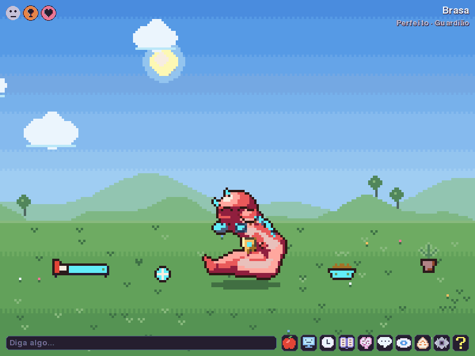</p>

Engrama é um companheiro no estilo V-Pet/tamagotchi. Ela nasce de um ovo, sente fome, sono, tédio e saudade, e cresce por ramos de evolução que dependem de como você cuida dela. Conversa com você por um modelo de linguagem **local**, lembra do que você contou e pode ajudar no dia a dia com lembretes e sessões de foco. Também adoece, envelhece e renasce como um ovo que herda um pouco da vida anterior.

Nada do que ela faz depende da internet. **Seus dados não saem do seu computador.**

<p align="center">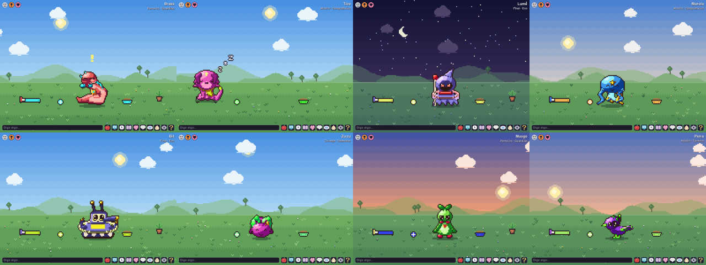</p>

<p align="center"><sub>Oito famílias, centenas de formas: cada criatura é desenhada a partir da própria semente e muda com o jeito como foi criada.</sub></p>

## Por que Engrama

<table>
<tr>
<td width="33%" valign="top"><b>🧠 Ela vive de verdade</b><br>Por trás do desenho há uma simulação: necessidades, humor, personalidade, aprendizado por reforço e uma rede neural de disparos que aprende a sua rotina. É essa mente que decide o que ela faz.</td>
<td width="33%" valign="top"><b>💬 Ela conversa com você</b><br>A voz vem de um modelo pequeno rodando no seu PC (Ollama). Ela lembra de fatos sobre você, tem opiniões próprias e reflete sobre as conversas. Sem modelo, ela balbucia e continua viva.</td>
<td width="33%" valign="top"><b>🔒 Ela respeita você</b><br>Tudo começa desligado. Você escolhe, fonte por fonte, o que ela pode perceber do PC, e vê e apaga tudo o que ela lembra. As ações são uma lista fechada, e cada uma tem uma chave própria.</td>
</tr>
</table>

## O que ela faz

<table>
<tr>
<td width="50%" valign="top">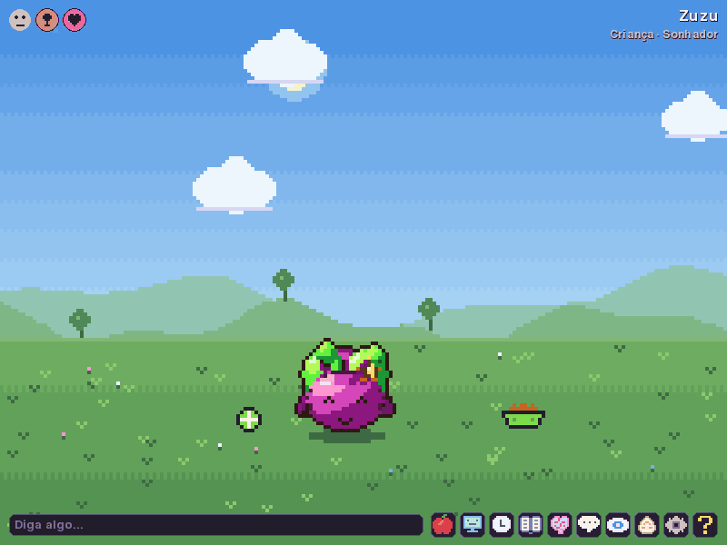<br><b>Cuidado.</b> Clique para fazer carinho, dê comida de verdade ou "comida digital" (bug frito, cookie de navegador, cache quentinho...) e remédio quando ela adoecer. Os ícones no canto mostram o que ela precisa.</td>
<td width="50%" valign="top">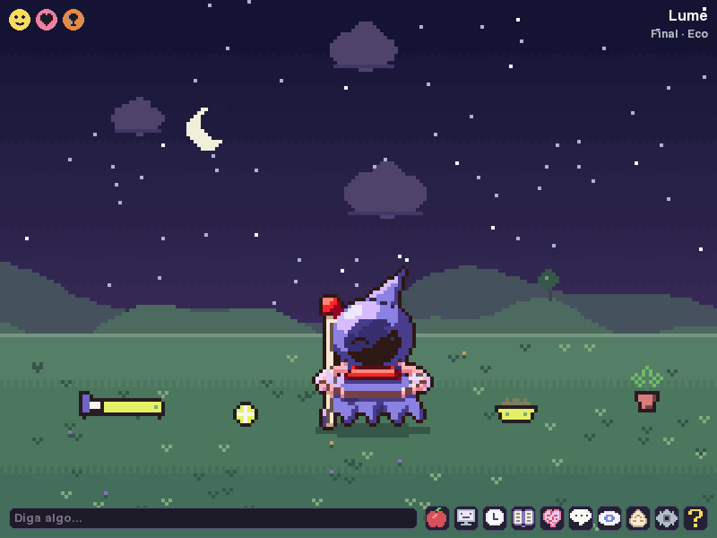<br><b>Conversa.</b> Escreva e ela responde com a própria personalidade, no tamanho de frase do estágio dela: bebês balbuciam, adultos opinam. A resposta acima é real, gerada pelo <code>qwen3:1.7b</code> sem internet.</td>
</tr>
<tr>
<td valign="top">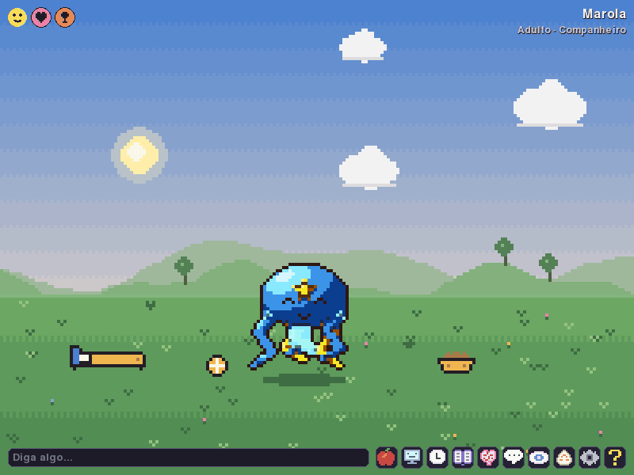<br><b>Lembretes.</b> "me lembra em 30 segundos de beber água": ela repete o tempo que entendeu e avisa na hora. O painel Ações lista os lembretes e liga cada função.</td>
<td valign="top">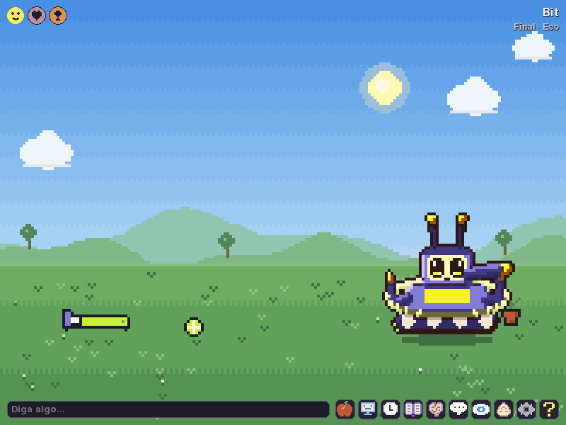<br><b>Foco.</b> "foco por 25 min": uma barra aparece no topo, ela fica quietinha e comemora no fim. Também dá para pedir anotações, que vão para a memória dela.</td>
</tr>
<tr>
<td valign="top">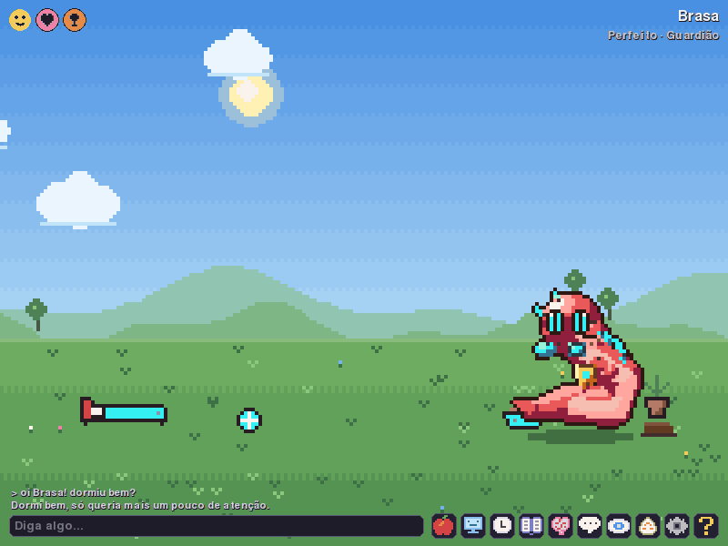<br><b>Visão da Mente.</b> Veja a mente pensar ao vivo: os módulos, as ações que cada um propõe, a vencedora destacada, as necessidades e os disparos da rede neural.</td>
<td valign="top">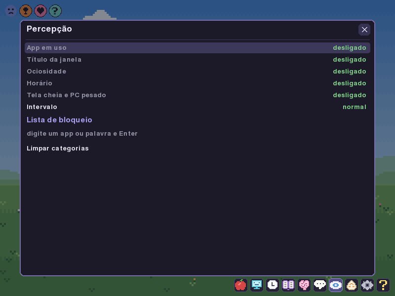<br><b>Privacidade.</b> Com a sua permissão, ela nota o tipo de app em uso (jogo, código, música) e comenta. Só a categoria é guardada, nunca o título ou o conteúdo. Os olhos fechados pausam tudo.</td>
</tr>
</table>

### Um terrário que segue o seu dia

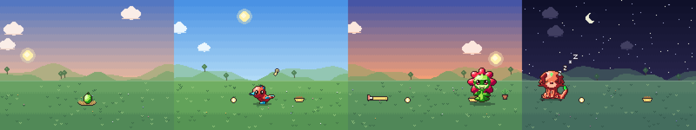

O céu acompanha o relógio do seu PC, com sol, lua, estrelas e nuvens. A casa cresce com ela: ninho, pote, bola, cama e planta, nas cores da criatura. Emotes mostram o que ela sente sem nenhum número: Zzz no sono, nota musical quando animada, gota quando triste, corações no carinho. No **modo sobreposição** (F11) ela sai da janela e anda sobre a barra de tarefas e as bordas das suas janelas.

### Uma vida inteira

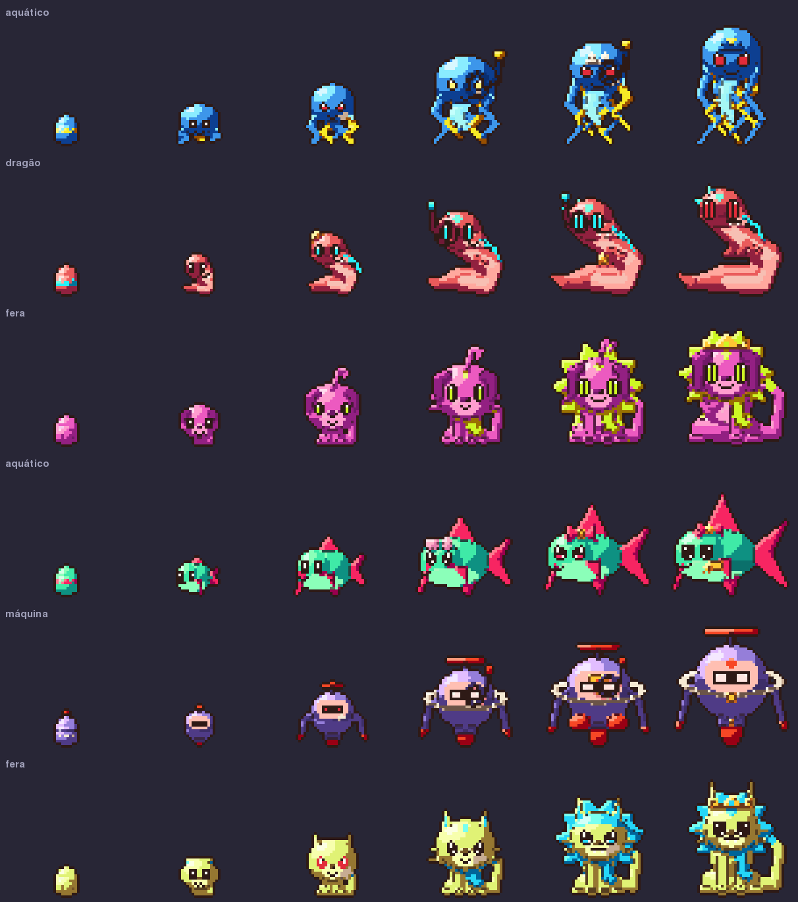

Ovo, bebê, criança, adulto, perfeito e final. Em cada evolução ela segue um ramo conforme o cuidado, a personalidade e os interesses que percebeu, e cada ramo deixa um acessório no visual.

| Estágio | Ramos |
|---|---|
| criança | brincalhão, curioso, sonhador, arisco |
| adulto | companheiro, explorador, artista, técnico, sombrio |
| perfeito | guardião, sábio, virtuoso, aventureiro, rebelde |
| final | lendário, mestre, eco, sombra |

Arisco, sombrio, rebelde e sombra vêm da negligência. No fim da vida ela envelhece e se despede; o próximo ovo herda parte da personalidade e até três lembranças antigas. O painel Gerações guarda a história de cada vida.

### Arte original, gerada na hora

<p align="center">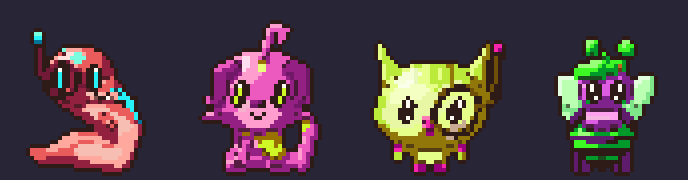</p>

Nenhum sprite vem de arquivo: oito famílias com três planos de corpo cada, cores do genoma, olhos e marcas da semente, membros animados por família. Mais em [docs/ART.md](docs/ART.md).

## Comece agora

1. Baixe o pacote da [página de Releases](https://github.com/alexzjss/engrama/releases): `engrama-<versão>-windows-x64.zip` ou `engrama-<versão>-linux-x64.tar.gz`. Não precisa de Python.
2. Extraia e abra `engrama` (`engrama\engrama.exe` no Windows, `./engrama/engrama` no Linux). No Windows, o SmartScreen avisa na primeira vez porque o build não é assinado: clique em **Mais informações** e depois em **Executar assim mesmo**.
3. Responda à tela de permissões. "Agora não" para tudo é uma resposta válida.
4. Clique no ovo até ele chocar, dê um nome e cuide dela.

**Para ela falar:** instale o [Ollama](https://ollama.com) e baixe o modelo pelo próprio app (**F5**) ou com `ollama pull qwen3:1.7b`. No Windows o app inicia e encerra o Ollama sozinho; no Linux ele usa o serviço que já estiver rodando. Opcional: `embeddinggemma` para ela lembrar pelo sentido, inclusive entre idiomas.

**Pelo código-fonte** (Python 3.13+):

```
python -m venv .venv && source .venv/bin/activate     # Windows: .venv\Scripts\activate
pip install -e .
python -m engrama
```

`engrama --install-desktop` cria um atalho no menu do sistema. Iniciar junto com o sistema é opcional e se liga em Configurações (F6).

## Como usar

A barra no canto de baixo tem um botão para cada painel (passe o mouse para ver o nome), e o **?** abre a ajuda. Os atalhos:

| Tecla | Painel | Tecla | Painel |
|---|---|---|---|
| **Enter** | enviar mensagem | **F7** | Memórias: ver e apagar |
| **F1** | Mundo digital | **F8** | Permissões da percepção |
| **F2** | Visão da Mente | **F9** | Olhos fechados (global: `Ctrl+Alt+E`) |
| **F3** | Descanso | **F10** | Gerações |
| **F4** | Comidas | **F11** | Terrário / sobreposição |
| **F5** | Modelos | **F12** | Modo dev |
| **F6** | Configurações | **Esc** | fechar o painel |

Arraste um arquivo para a janela e ela comenta o conteúdo (lê só o começo de textos e códigos). Todas as opções de linha de comando, onde ficam os dados e um roteiro de demonstração de 5 minutos estão no [Guia de uso](docs/GUIDE.md).

## Privacidade

- **Tudo local.** O modelo roda no seu Ollama e o app não fala com nenhum servidor. Os dados ficam em `%APPDATA%\Engrama` (Windows) ou `~/.local/share/engrama` (Linux).
- **Percepção opt-in, fonte por fonte:** app em foco, título, ociosidade, horário, tela cheia, carga do PC. Apps de banco e de senhas já vêm bloqueados, e você adiciona os seus.
- **Só o resumo é guardado:** a categoria do app e um tema curto. Nunca títulos crus, caminhos ou conteúdo de arquivos. Teclado, tela e área de transferência nunca são lidos.
- **Você controla a memória:** apague um fato, um assunto, uma opinião ou tudo de uma vez. Apagar é definitivo.
- **Ações numa lista fechada:** lembretes, foco e anotações, cada um ligado por você. Nada de shell, rede ou arquivos.
- **Nada baixa sozinho:** modelos só são baixados quando você pede. Com `--no-llm` o Ollama nunca é contatado.

## Plataformas

| Sistema | Terrário | Percepção | Sobreposição |
|---|---|---|---|
| Windows | ✅ | ✅ completa | ✅ |
| Linux X11 | ✅ | ✅ completa | ✅ |
| Linux Wayland: Hyprland | ✅ | ✅ completa | ✅ |
| Linux Wayland: Sway | ✅ | ✅ completa | ainda não |
| Linux Wayland: KDE, GNOME | ✅ | só ociosidade | ainda não |

O app mira no máximo 150 MB de RAM e 2% de CPU. Ele descansa sozinho em tela cheia, com pouca memória livre ou depois de 30 minutos sem uso, e descarrega o modelo nesse período. Detalhes de cada sessão Linux no [Guia de uso](docs/GUIDE.md).

## Por dentro

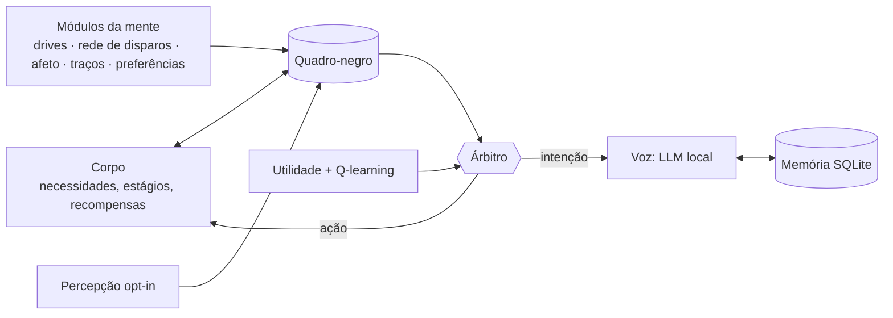

O corpo é determinístico. A mente é feita de módulos trocáveis, combinados por receitas TOML. O LLM só escreve as frases e **nunca escolhe as ações**. Um laboratório simula semanas de vida em segundos para comparar mentes diferentes; as criaturas desta página foram criadas assim. Arquitetura, testes, laboratório e ferramentas estão em [docs/DEVELOPMENT.md](docs/DEVELOPMENT.md).

## Estado do projeto

**0.20.0: MVP completo.** Ciclo de vida inteiro com evolução por ramos, doença, morte e gerações; conversa e memória locais; percepção com permissão; terrário com dia e noite; sobreposição no desktop; lembretes, foco e anotações; Windows e Linux; pacotes prontos nas Releases. Vinte marcos entregues, com CI em Ubuntu e Windows.

**Próximos passos:** a rotina que a rede neural aprende vai virar comportamento visível (esperar você no horário de sempre, notar atrasos), e o sono vai repassar as experiências do dia. Também estão planejados lembretes com hora marcada ("às 15h") e a sobreposição no Sway, KDE e GNOME. Limitações conhecidas e o roadmap completo estão em [docs/DEVELOPMENT.md](docs/DEVELOPMENT.md#estado-do-mvp-e-roadmap).

## Documentação

| | |
|---|---|
| [Guia de uso](docs/GUIDE.md) | teclas, linha de comando, dados, descanso, Linux, roteiro de demonstração |
| [Desenvolvimento](docs/DEVELOPMENT.md) | arquitetura, testes, laboratório, receitas, módulos, ferramentas, roadmap |
| [Arte](docs/ART.md) | famílias, planos de corpo, paleta, animações |
| [Especificações e relatórios](docs/superpowers/) | o desenho e o resultado de cada marco |

## Licença

[MIT](LICENSE).

---

<a id="en"></a>

<h1 align="center">Engrama</h1>

<p align="center"><b>A virtual pet that lives on your computer, with a real mind and a voice that never leaves your machine.</b></p>

<p align="center">
<a href="https://github.com/alexzjss/engrama/releases"><b>Download</b></a> ·
<a href="#get-started">Get started</a> ·
<a href="docs/videos/demo-reel.mp4">Demo video</a> ·
<a href="docs/GUIDE.md#en">User guide</a> ·
<a href="#top">Português</a>
</p>

Engrama is a V-Pet/tamagotchi style companion. She hatches from an egg, feels hunger, sleepiness, boredom and longing, and grows along evolution branches that depend on how you care for her. She talks to you through a **local** language model, remembers what you told her and can help day to day with reminders and focus sessions. She also gets sick, grows old and is reborn as an egg that inherits a little of the previous life.

Nothing she does needs the internet. **Your data never leaves your computer.**

<p align="center"></p>

## Why Engrama

<table>
<tr>
<td width="33%" valign="top"><b>🧠 She is really alive</b><br>Behind the sprite there is a simulation: needs, mood, personality, reinforcement learning and a spiking neural network that learns your routine. That mind decides what she does.</td>
<td width="33%" valign="top"><b>💬 She talks with you</b><br>Her voice comes from a small model running on your PC (Ollama). She remembers facts about you, has opinions of her own and reflects on conversations. Without a model she babbles and stays alive.</td>
<td width="33%" valign="top"><b>🔒 She respects you</b><br>Everything starts off. You choose, source by source, what she may perceive on the PC, and you see and delete everything she remembers. Actions are a closed list, and each one has its own switch.</td>
</tr>
</table>

## What she does

<table>
<tr>
<td width="50%" valign="top"><br><b>Care.</b> Click to pet her, give real food or "digital food" (fried bug, browser cookie, warm cache...) and medicine when she gets sick. The icons in the corner show what she needs.</td>
<td width="50%" valign="top"><br><b>Chat.</b> Type and she answers with her own personality, at the sentence length of her stage: babies babble, adults have opinions. The reply above is real, written by <code>qwen3:1.7b</code> with no internet.</td>
</tr>
<tr>
<td valign="top"><br><b>Reminders.</b> "remind me in 30 seconds to drink water": she repeats the time she understood and tells you when it is due. The Actions panel lists the reminders and switches each feature on.</td>
<td valign="top"><br><b>Focus.</b> "focus for 25 min": a bar shows at the top, she keeps quiet and celebrates at the end. You can also ask for notes, which go to her memory.</td>
</tr>
<tr>
<td valign="top"><br><b>Mind View.</b> Watch the mind think live: the modules, the actions each one proposes, the winner highlighted, the needs and the spikes of the neural network.</td>
<td valign="top"><br><b>Privacy.</b> With your permission she notices the kind of app in use (game, code, music) and comments. Only the category is kept, never the title or the content. Closed eyes pause everything.</td>
</tr>
</table>

<sub>The captures show the app in Portuguese; the interface is also in English and follows the system language.</sub>

### A terrarium that follows your day


The sky follows your PC clock, with sun, moon, stars and clouds. The home grows with her: nest, bowl, ball, bed and plant, in the creature's own colours. Emotes show what she feels without a single number: Zzz when asleep, a note when excited, a drop when sad, hearts when petted. In **overlay mode** (F11) she leaves the window and walks on your taskbar and on the edges of your windows.

### A whole life


Egg, baby, child, adult, perfect and final. At each evolution she follows a branch according to care, personality and the interests she noticed, and each branch leaves an accessory on her look.

| Stage | Branches |
|---|---|
| child | playful, curious, dreamer, aloof |
| adult | companion, explorer, artist, technician, gloomy |
| perfect | guardian, sage, virtuoso, adventurer, rebel |
| final | legendary, master, echo, shadow |

Aloof, gloomy, rebel and shadow come from neglect. At the end of her life she grows old and says goodbye; the next egg inherits part of the personality and up to three old memories. The Generations panel keeps the story of every life.

### Original art, generated on the fly

<p align="center"></p>

No sprite comes from a file: eight families with three body plans each, colours from the genome, eyes and markings from the seed, limbs animated per family. More in [docs/ART.md](docs/ART.md#en).

## Get started

1. Download the package from the [Releases page](https://github.com/alexzjss/engrama/releases): `engrama-<version>-windows-x64.zip` or `engrama-<version>-linux-x64.tar.gz`. No Python needed.
2. Extract it and open `engrama` (`engrama\engrama.exe` on Windows, `./engrama/engrama` on Linux). On Windows, SmartScreen warns the first time because the build is not signed: click **More info**, then **Run anyway**.
3. Answer the permissions screen. "Not now" to everything is a valid answer.
4. Click the egg until it hatches, give her a name and take care of her.

**To make her talk:** install [Ollama](https://ollama.com) and download the model from the app itself (**F5**) or with `ollama pull qwen3:1.7b`. On Windows the app starts and stops Ollama by itself; on Linux it uses the service already running. Optional: `embeddinggemma`, so she remembers by meaning, even across languages.

**From source** (Python 3.13+):

```
python -m venv .venv && source .venv/bin/activate     # Windows: .venv\Scripts\activate
pip install -e .
python -m engrama
```

`engrama --install-desktop` adds a shortcut to the system menu. Starting with the system is optional and is switched on in Settings (F6).

## Usage

The bar at the bottom has a button for each panel (hover to see its name), and **?** opens the help. The shortcuts:

| Key | Panel | Key | Panel |
|---|---|---|---|
| **Enter** | send a message | **F7** | Memories: view and delete |
| **F1** | Digital world | **F8** | Perception permissions |
| **F2** | Mind View | **F9** | Eyes closed (global: `Ctrl+Alt+E`) |
| **F3** | Rest | **F10** | Generations |
| **F4** | Foods | **F11** | Terrarium / overlay |
| **F5** | Models | **F12** | Dev mode |
| **F6** | Settings | **Esc** | close the panel |

Drop a file on the window and she comments on it (she reads only the start of text and code). Every command line option, where the data lives and a 5-minute demo script are in the [User guide](docs/GUIDE.md#en).

## Privacy

- **All local.** The model runs in your Ollama and the app talks to no server. The data lives in `%APPDATA%\Engrama` (Windows) or `~/.local/share/engrama` (Linux).
- **Opt-in perception, source by source:** app in focus, title, idle time, hour, fullscreen, PC load. Banking and password apps come blocked, and you add your own.
- **Only the summary is kept:** the app category and a short topic. Never raw titles, paths or file contents. Keyboard, screen and clipboard are never read.
- **You control the memory:** delete one fact, topic or opinion, or everything at once. Deleting is final.
- **Actions in a closed list:** reminders, focus and notes, each switched on by you. No shell, network or files.
- **Nothing downloads by itself:** models are only downloaded when you ask. With `--no-llm` Ollama is never contacted.

## Platforms

| System | Terrarium | Perception | Overlay |
|---|---|---|---|
| Windows | ✅ | ✅ full | ✅ |
| Linux X11 | ✅ | ✅ full | ✅ |
| Linux Wayland: Hyprland | ✅ | ✅ full | ✅ |
| Linux Wayland: Sway | ✅ | ✅ full | not yet |
| Linux Wayland: KDE, GNOME | ✅ | idle time only | not yet |

The app aims at 150 MB of RAM and 2% CPU at most. It rests by itself in fullscreen, with little free memory or after 30 minutes without use, and unloads the model meanwhile. Details for each Linux session in the [User guide](docs/GUIDE.md#en).

## Inside

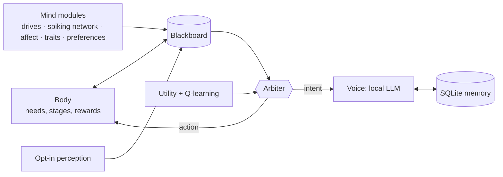

The body is deterministic. The mind is made of swappable modules, combined by TOML recipes. The LLM only writes the sentences and **never chooses the actions**. A lab simulates weeks of life in seconds to compare different minds; the creatures on this page were raised that way. Architecture, tests, lab and tools are in [docs/DEVELOPMENT.md](docs/DEVELOPMENT.md#en).

## Project status

**0.20.0: complete MVP.** The whole life cycle with branch evolution, sickness, death and generations; local chat and memory; perception with permission; a terrarium with day and night; desktop overlay; reminders, focus and notes; Windows and Linux; ready-made packages in Releases. Twenty milestones delivered, with CI on Ubuntu and Windows.

**Next:** the routine the neural network learns will become visible behaviour (waiting for you at the usual hour, noticing when you are late), and sleep will replay the day's experiences. Also planned: reminders at a set time ("at 3 pm") and the overlay on Sway, KDE and GNOME. Known limitations and the full roadmap are in [docs/DEVELOPMENT.md](docs/DEVELOPMENT.md#mvp-status-and-roadmap).

## Documentation

| | |
|---|---|
| [User guide](docs/GUIDE.md#en) | keys, command line, data, rest, Linux, demo script |
| [Development](docs/DEVELOPMENT.md#en) | architecture, tests, lab, recipes, modules, tools, roadmap |
| [Art](docs/ART.md#en) | families, body plans, palette, animations |
| [Specs and reports](docs/superpowers/) | the design and the outcome of each milestone |

## License

[MIT](LICENSE).
