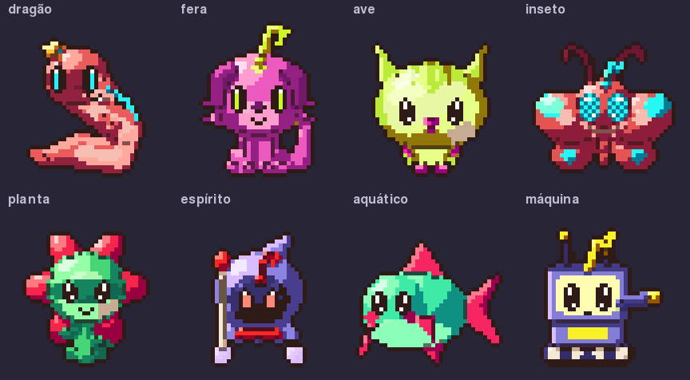
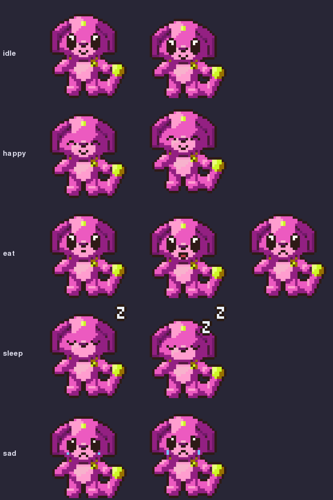
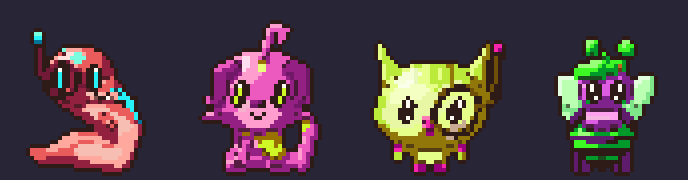

# Arte / Art

**PT** | [EN](#en)

## Arte

Todos os sprites são **procedurais e originais**, no estilo V-Pet: contorno escuro de 1 px, rampa curta de tons, olhos grandes. Nada vem de arquivo de imagem: cada criatura é gerada da semente.

- **Oito famílias, três planos de corpo cada** (fixos pela vida toda, definidos pela semente): dragão (quadrúpede, bípede, serpente), fera (quadrúpede, sentada, bípede), ave (empoleirada, coruja, em voo), inseto (besouro, abelha, mariposa), planta (bulbo, flor, cacto), espírito (lençol, chama, encapuzado), aquático (água-viva, peixe, anfíbio), máquina (bípede, tanque, drone).
- **Coesão:** o plano de corpo só muda de proporção por estágio (bebê = cabeça enorme; adulto, perfeito e final alongam). Chifres, orelhas, caudas, nadadeiras e asas crescem com o estágio. Os genes da semente (tipo de chifre/orelha, marcações, estilo dos olhos, proporções finas) são os mesmos em todos os estágios, então dá para reconhecer a criatura ao crescer. Os olhos variam por família e semente (fenda, facetado, aceso, visor...).
- **Personalidade e ramo aparecem no desenho:** curiosidade aumenta cabeça e olhos; sociabilidade abre os braços; paciência alarga o corpo; independência afina e alonga. Cada ramo dá um acessório (cachecol, óculos, boina, capa, coroa...) que continua nos estágios seguintes (até 3, o mais recente em destaque), e os de negligência dão olhos vermelhos.
- **Paleta:** 3 tons de corpo com deslocamento de matiz, 1 acento, contorno quente fixo; o matiz base é o do genoma e se mantém a vida inteira.
- **Ovo:** já nasce na cor da família, com um motivo pequeno (zigue-zague, manchas, broto, rebites...).
- **Saves antigos** continuam valendo: família, plano e genes saem da semente e da linhagem já salvas; nenhum campo novo no genoma.
- **Animações** (as mesmas do app: `idle`, `walk`, `eat`, `sleep`, `happy`, `sad`, `sick`, `evolve`, `old`, `dead`):

- **Membros animados:** pernas, braços, caudas, asas, nadadeiras, orelhas e antenas giram em torno da junta, em poses próprias por família e plano (`walk` alterna as pernas; `happy` levanta os braços ou asas; `sleep` recolhe os membros). Ovo, `sick`, `evolve` e `dead` ficam em repouso, como antes (salvo o dragão quadrúpede adulto, que ficou mais leve de propósito); a cauda cai em `old`. Exemplo de `walk`, quatro famílias adultas:

O gerador mora em `engrama/app/art/vpet/`. Para regenerar as imagens: `SDL_VIDEODRIVER=dummy python -m spike.vpet2.showcase` (usa a API do app e grava em `docs/images/`); folhas de revisão: `python -m spike.vpet2.sheets <pasta>`. Detalhes e limitações no [README da arte](../spike/vpet2/README.md).

---

**[PT](#top)** | EN

## Art

All sprites are **procedural and original**, in the V-Pet style: 1 px dark outline, short tone ramp, big eyes. Nothing comes from an image file: each creature is generated from its seed.

- **Eight families, three body plans each** (fixed for life, set by the seed): dragon (quadruped, biped, serpent), beast (quadruped, sitting, biped), bird (perching, owl, in flight), insect (beetle, bee, moth), plant (bulb, flower, cactus), spirit (sheet, flame, hooded), aquatic (jellyfish, fish, amphibian), machine (biped, tank, drone).
- **Cohesion:** the body plan only changes proportions per stage (baby = huge head; adult, perfect and final stretch out). Horns, ears, tails, fins and wings grow with the stage. The seed's genes (horn/ear type, markings, eye style, fine proportions) are the same at every stage, so you recognise the creature as it grows. Eyes vary by family and seed (slit, compound, glowing, visor...).
- **Personality and branch show in the drawing:** curiosity enlarges head and eyes; sociability opens the arms; patience widens the body; independence slims and lengthens. Each branch adds an accessory (scarf, glasses, beret, cape, crown...) that carries over to later stages (up to 3, the latest most prominent), and the neglect branches give red eyes.
- **Palette:** 3 body tones with hue shift, 1 accent, a fixed warm outline; the base hue is the genome's and stays the same for life.
- **Egg:** already in the family colour, with a small motif (zigzag, spots, sprout, rivets...).
- **Old saves** still work: family, plan and genes come from the saved seed and lineage; no new genome fields.
- **Animations** (the same ones the app uses: `idle`, `walk`, `eat`, `sleep`, `happy`, `sad`, `sick`, `evolve`, `old`, `dead`):

- **Animated limbs:** legs, arms, tails, wings, fins, ears and antennae rotate around their joints, with poses of their own per family and body plan (`walk` alternates the legs; `happy` raises the arms or wings; `sleep` tucks the limbs in). The egg, `sick`, `evolve` and `dead` stay at rest as before (except the adult quadruped dragon, which is lighter on purpose); the tail droops in `old`. Example of `walk`, four adult families:

The generator lives in `engrama/app/art/vpet/`. To regenerate the images: `SDL_VIDEODRIVER=dummy python -m spike.vpet2.showcase` (uses the app API, writes to `docs/images/`); review sheets: `python -m spike.vpet2.sheets <dir>`. Details and limitations in the [art README](../spike/vpet2/README.md) (Portuguese).
