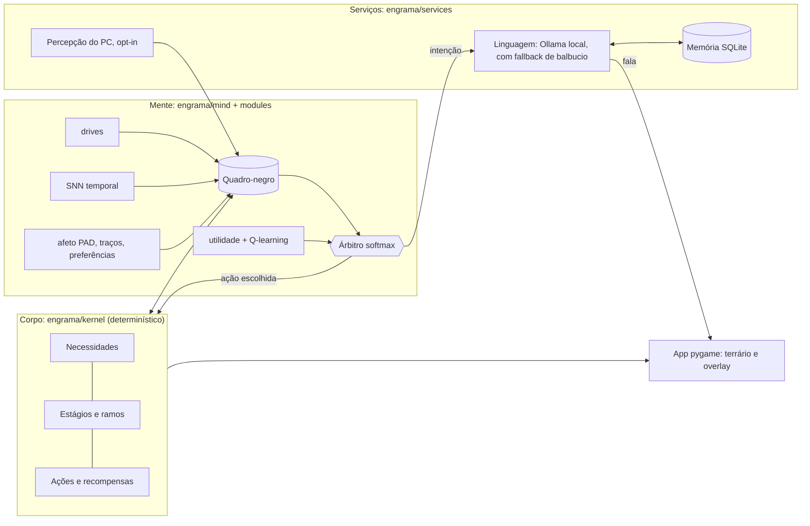
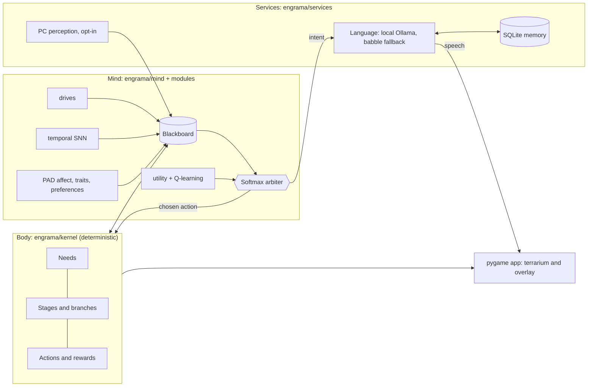

<a id="top"></a>

# Desenvolvimento / Development

**PT** | [EN](#en)

## Como funciona por dentro



| Camada | Pacote | Papel | Detalhe técnico |
|---|---|---|---|
| **Corpo** | `engrama/kernel` | Necessidades, estágios, ações, recompensas, genoma | Determinístico: mesma semente, mesmo resultado |
| **Mente** | `engrama/mind`, `engrama/modules` | Módulos trocáveis que propõem ações | Contrato `Module` (`reads`, `writes`, `rate_hz`, `step`, `propose`, `learn`), quadro-negro e árbitro softmax; receitas TOML escolhem módulos e pesos |
| **Voz** | `engrama/services/language` | Transforma intenção em frase | Fila de jobs priorizada (conversa > comentário > reflexão > fatos), nunca levanta exceção para quem chama; **nunca escolhe ações** |
| **Memória** | `engrama/services/memory` | Fatos, assuntos, opiniões, reflexões | SQLite local, tetos fixos, busca por palavras e (opcional) por significado com embeddings |
| **Percepção** | `engrama/services/perception`, `engrama/osapi` | App em foco, ociosidade, tela cheia, carga | Opt-in por fonte, lista de bloqueio, só categoria e tema curto são guardados; backends Windows, X11, Wayland |
| **Laboratório** | `engrama/lab` | Simula semanas em segundos | Perfis de usuário simulados, log de experiência em SQLite, replay, métricas, suíte de comparação de receitas |
| **App** | `engrama/app` | Janela, arte, áudio, i18n PT/EN | pygame-ce, sprites **procedurais** a partir da semente (8 famílias × 3 planos), sobreposição sem borda |

- **Orçamento de recursos:** alvo de 150 MB de RAM e 2% de CPU em regime estável (`tools/bench.py`), com descanso manual e automático (2 FPS, mente em ritmo reduzido, LLM descarregado).
- **Mente de verdade:** a SNN temporal avança em compassos de 60 s de tempo simulado; afeto em três eixos (PAD); Q-learning e utilidade disputam cada tick; a Visão da Mente mostra tudo ao vivo.
- **Regras de dependência** entre camadas são verificadas por `tests/test_architecture.py`; a CI roda ruff e testes em Ubuntu e Windows.

## Para desenvolvedores

### Ambiente e testes

```
python -m venv .venv                     # Python 3.13
source .venv/bin/activate                # Windows: .venv\Scripts\activate
pip install -e .[dev]                    # pytest, pytest-xdist, ruff
```

```
SDL_VIDEODRIVER=dummy SDL_AUDIODRIVER=dummy python -m pytest -n auto
$env:SDL_VIDEODRIVER="dummy"; $env:SDL_AUDIODRIVER="dummy"; python -m pytest -n auto   # Windows (PowerShell)
python -m pytest -n auto --dist loadgroup -m "not perf"   # tudo, menos os testes de orçamento de tempo (o que a CI roda)
python -m pytest -n 4 -m "not slow and not perf"          # laço rápido do dia a dia (cerca de 1,5 min)
python -m pytest -m perf                 # só os testes de orçamento (tempo, CPU, FPS)
ruff check .                             # lint
```

- Uma execução completa e serial leva cerca de 40 min; `-n auto` (pytest-xdist) é bem mais rápido. O laço rápido pula os testes marcados `slow` (simulações de dias e acordos de aceitação, acima de uns 5 s cada); rode a suíte completa antes de abrir o PR. Testes que dividem uma mesma simulação ficam no mesmo `xdist_group`, por isso o `--dist loadgroup`; `tests/conftest.py` põe os grupos mais longos para começar primeiro.
- **Golden de sprites:** `tests/app/test_sprite_golden.py` compara o hash de cada sprite com `tests/fixtures/m12_sprite_hashes.json`, e pega mudança de arte que você não queria. Quando a mudança for intencional, regenere com `ENGRAMA_REGEN_GOLDEN=1 python -m pytest tests/app/test_sprite_golden.py` (PowerShell: `$env:ENGRAMA_REGEN_GOLDEN="1"`) e commite o JSON junto com a arte.
- **CI** (`.github/workflows/ci.yml`), em cada PR: lint com ruff e testes funcionais (`-m "not perf"`, bloqueantes) em Ubuntu e Windows, Python 3.13. Os testes `perf` rodam depois, só informativos.

### Arquitetura

- `engrama/kernel`: corpo determinístico (mesma semente, mesmo resultado; uma simulação completa também é determinística, pois o laboratório não rebaixa módulos por tempo real, ver `--enforce-budgets`).
- `engrama/mind`, `engrama/modules`: contratos, registro e módulos da mente.
- `engrama/lab`: runtime de simulação, log de experiência (SQLite), replay, métricas e CLI.
- `engrama/app`: o app (interface, arte, host, `cli.py` para a linha de comando, serviços de percepção, memória, LLM).
- `engrama/recipes/`: receitas TOML que escolhem os módulos e seus pesos; `docs/superpowers/` guarda especificações, planos e relatórios de cada marco.

Regra de dependência (verificada por `tests/test_architecture.py`): `kernel` não importa `mind`, `modules`, `lab` nem `services`; `mind` não importa `kernel` nem `modules`; um módulo só importa `engrama.mind`, `engrama.vocab`, `engrama.balance`, a própria família, numpy e a stdlib.

### Receitas

`minimal-v1` e `default-v1` são os exemplos básicos. As demais são experimentos de ML opcionais (M10), **sem efeito no padrão** (`default-v1` não mudou):

| Receita | O que troca em relação a `default-v1` |
|---|---|
| `ctrnn-v1` | SNN temporal por CTRNN (tempo contínuo, constantes de 1 min a 1 dia) |
| `shadow-ctrnn-v1` | CTRNN só em sombra (ações iguais às do padrão; dá o Brier próprio da CTRNN) |
| `curious-v1` | Q-learning por Q curioso + modelo de mundo (bônus por erro) |
| `curious-lp-v1` | o mesmo, com bônus por progresso de aprendizado |
| `thompson-v1` | Q-learning por Thompson (incerteza vira exploração) |
| `aif-v1` | Q-learning somado à inferência ativa |
| `aif-solo-v1` | inferência ativa no lugar da utilidade e do Q-learning (exploratória) |
| `lab-shadow-all-v1` | padrão ao vivo, com CTRNN, Thompson, inferência ativa e modelo de mundo em sombra |

Resumo do [relatório de comparação](superpowers/reports/2026-11-08-m10-experimentos.md) (3 sementes): nenhuma receita supera o padrão de forma consistente e relevante, todas cabem no orçamento; a recomendação é **não promover** nenhuma.

### Laboratório

```
python -m engrama.lab sim --recipe engrama/recipes/default-v1.toml --days 7 --profile gamer --seed 1 --log data/run.db
python -m engrama.lab report --log data/run.db
python -m engrama.lab compare --a engrama/recipes/minimal-v1.toml --b engrama/recipes/default-v1.toml --days 10
python -m engrama.lab replay --log data/run.db --module temporal.snn --param readout_hidden=false
python -m engrama.lab suite --recipes default-v1 thompson-v1 --profiles attentive --seeds 1 --days 1 --out suite.json --md suite.md
python -m engrama.lab suite --preset m10 --jobs 4 --out suite.json --md tabela.md   # 8 receitas x 4 perfis x 3 sementes
```

`suite` roda receitas x perfis x sementes, grava o JSON (corridas e resumo pareado contra `--baseline`, padrão `default-v1`) e a tabela em Markdown; `--jobs N` usa N processos e não muda o resultado. O `--preset m10` leva cerca de 5 min com `--jobs 4` (medido em 8 núcleos).

Perfis (`--profile`): `attentive`, `absent`, `night_owl`, `gamer`. Outras flags: `--dt` (passo em segundos simulados, padrão 60), `--save DIR` (salva o estado ao fim do `sim`), `--run ID` (escolhe a execução dentro de um log, em `report` e `replay`), `--seed`, `--enforce-budgets` (rebaixa módulos lentos pelo relógio de parede; não determinístico, desligado por padrão). Cada `sim --log` cria uma execução com `run_id` único, impresso junto com o nome e a versão da receita.

### Escrever um módulo

1. Subclasse `engrama.mind.contracts.Module`: declare `reads`, `writes`, `rate_hz`; implemente `step(bb, dt)`, `propose(bb)`, `learn(exp)`, `state_dict`/`load_state_dict` (o `state_dict` leva um `version` inteiro; `load_state_dict({})` volta ao estado inicial e versão maior levanta `ValueError`).
2. Registre em `engrama/mind/registry.py` (`REGISTRY["familia.nome"] = "pacote.arquivo:Classe"`).
3. Adicione a uma receita como `[[module]]` (vivo, com `weight`) ou `[[shadow]]` (roda e é registrado, mas não decide).
4. Opcional: `lab_metrics()` devolve um dict de números; a suíte do laboratório os agrega por corrida.

### O que a SNN comprova (e o que não)

- Comprovado: em um usuário periódico roteirizado, a SNN prevê o próximo evento melhor que uma leitura só com viés (Brier 4,0% a 5,1% menor nas sementes 1, 2 e 3; o teste exige pelo menos 2% em cada uma).
- O sinal de novidade e a habituação vêm principalmente da taxa-base de cada tipo de evento, não da rede de disparos.
- `minimal` contra `default` é uma diferença de receita inteira, não um efeito só da SNN.
- A SNN avança em compassos fixos de 60 s de tempo simulado, então o resultado não depende do `--dt`.

### Testes e bench

```
python tools/bench.py --seconds 120      # (--profile, --seed) JSON: pico de RSS, CPU médio, mean_ms por módulo
python tools/bench.py --app --seconds 60 --fake-perception   # o app inteiro com fontes de percepção falsas
python tools/bench.py --app --seconds 60 --threads           # CPU por thread (Linux, via /proc)
python tools/bench.py --app --seconds 60 --first-use         # mede a tela de primeiro uso, à parte
python tools/bench.py --overlay --seconds 30                 # overlay com desktop e cursor falsos
```

O bench mede o estado estável (primeiro uso já respondido, todas as permissões desligadas); o limite é de 150 MB e 2% de CPU médio, em qualquer plataforma. Para os testes, veja [Ambiente e testes](#ambiente-e-testes).

### Ferramentas com modelo real (Ollama)

Precisam do Ollama rodando, com `qwen3:1.7b` e `embeddinggemma` baixados. Não baixam modelos nem iniciam o Ollama.

```
python tools/smoke_llm.py --out pasta_nova --repeat 3                              # roteiros de conversa: rejeições, atendente, idioma, fatos
python tools/calibrate_sem.py --out resultado.json --md resultado.md               # calibra os limiares da busca por significado (embeddinggemma)
```

- `tools/smoke_llm.py`: harness de conversa. Roda roteiros por estágio (`--stages`, `--langs`) pelo serviço de linguagem real e grava `transcripts.json` e `summary.md` em `--out`. Veja [o relatório da calibração](superpowers/reports/2026-11-04-m13-calibracao.md).
- `tools/demo_reel.py --out demo-media`: grava vídeos e capturas do app real para demonstração. Cria oito criaturas com o simulador (uma por família), abre o app sem janela em cada uma e segue um roteiro (carinho, comida, uma mensagem, às vezes um painel). Salva um MP4 por criatura e um `reel.mp4` em `video/`, PNGs dos momentos em `stills/`, `demo.gif` e `pets.png`. Precisa do `ffmpeg`; com `--no-llm` as respostas viram balbucio. Leva uns 10 minutos.
- `tools/calibrate_sem.py`: varre limiares de 0,15 a 0,90 sobre `tools/data/sem_pairs.jsonl` e reporta precisão, recall e F1 por tipo de memória.

## Estado do MVP e roadmap

| Marco | Entrega | Estado |
|---|---|---|
| M1–M2 | Núcleo determinístico, mente modular, receitas, laboratório | feito |
| M3 | O app: corpo e voz (Ollama), Visão da Mente, descanso | feito |
| M4 | Memória viva (fatos, assuntos, opiniões, reflexão, iniciativa) | feito |
| M5 | Percepção do PC com permissões e privacidade | feito |
| M6 | Vida longa: ramos, doença, velhice, morte, gerações | feito |
| M7 | Presença: overlay, mini-menu, mundo digital, variantes | feito |
| M8 | Linux (X11 e Wayland) | feito |
| M9 | Busca por significado (embeddings, opcional) | feito |
| M10 | Experimentos de ML como receitas opcionais + relatório | feito |
| M11 | Arte V-Pet coesa: 8 famílias × 3 planos, ovos da família, acessórios que acumulam | feito |
| M12 | Saúde do projeto: CI Linux/Windows, lint, testes paralelos, divisão dos arquivos grandes, bench no Wayland | feito |
| M13 | Calibração com modelo real: persona (harness de conversas), limiares da busca por significado, smokes manuais | parcial |
| M14 | Animação de membros e poses por família (pernas, braços, caudas, asas, nadadeiras) | feito |
| M15 | Distribuição: pasta de dados do sistema, Ollama sem disco fixo, pacotes Windows e Linux, atalho e início automático opcional | feito |
| M16 | Saúde 2: CI verde, testes mais rápidos | feito |
| M17 | Habitação no desktop: overlay no Hyprland, geometria das janelas, andar nas bordas, pular, cair, reagir ao cursor | feito |
| MVP 1 | UI/UX: barra de botões, ajuda, HUD com ícones e dicas, painéis que fecham, nome da criatura | feito |
| M18 | Casa e ritmo: terrário com dia e noite, objetos da casa, emotes pelo afeto, sombra e balões com contorno | feito |
| M20 | Agir com permissão: lembretes, foco e anotações, por chat ou painel, com extração por regras e JSON do LLM como reserva | feito |
| M19 | Mente visível: rotina prevista vira comportamento, sonhos como replay de experiência | pós-MVP |

**Limitações conhecidas**

- Smokes manuais de alguns marcos continuam pendentes de relato (por exemplo a busca por significado com o modelo real baixado).
- Overlay: funciona em Windows, X11 e Hyprland. Em Sway, KDE e GNOME (Wayland) ainda não. No Hyprland o clique não atravessa a janela justa em volta do corpo, e o conversar (teclado) depende de o Hyprland dar foco à janela (com `follow_mouse` ligado ele passa o foco quando o cursor está sobre ela).
- No Wayland, KDE e GNOME não expõem app em foco/título/tela cheia à percepção.
- Os experimentos de ML não foram promovidos: o padrão continua sendo `default-v1`.
- O orçamento de 2% de CPU é por núcleo; em notebooks de baixo consumo o número medido pode ser maior que no PC de referência.
- Sem ícone na bandeja do sistema nesta versão: a própria janela (ou o modo sobreposição) é a presença.

**Próximos passos** (pós-MVP; detalhes no [roadmap](superpowers/specs/2026-11-06-engrama-m16-m20-roadmap.md))

1. **M19:** a rotina prevista pela SNN vira comportamento visível (esperar no horário de costume, notar atrasos) e o sono faz replay de experiência, medido no laboratório.
2. **Ações:** lembretes com hora marcada ("às 15h") ainda não são entendidos, só durações; as chaves ficam no painel Ações, não no F8.
3. **M13:** fechar o aceite (média de 3 repetições do harness, atendente no texto final e CI) e a checklist humana; relatório em [`docs/superpowers/reports/`](superpowers/reports/2026-11-04-m13-calibracao.md).

Especificações, planos e relatórios de cada marco: [`docs/superpowers/`](superpowers/).

---

<a id="en"></a>
**[PT](#top)** | EN

## How it works inside



| Layer | Package | Role | Technical detail |
|---|---|---|---|
| **Body** | `engrama/kernel` | Needs, stages, actions, rewards, genome | Deterministic: same seed, same outcome |
| **Mind** | `engrama/mind`, `engrama/modules` | Swappable modules that propose actions | `Module` contract (`reads`, `writes`, `rate_hz`, `step`, `propose`, `learn`), blackboard and softmax arbiter; TOML recipes pick modules and weights |
| **Voice** | `engrama/services/language` | Turns intent into a sentence | Prioritised job queue (chat > remark > reflection > facts), never raises into the caller; **never picks actions** |
| **Memory** | `engrama/services/memory` | Facts, subjects, opinions, reflections | Local SQLite, fixed caps, keyword and (optional) embedding-based meaning search |
| **Perception** | `engrama/services/perception`, `engrama/osapi` | Focused app, idleness, fullscreen, load | Opt-in per source, blocklist, only category and a short theme are stored; Windows, X11, Wayland backends |
| **Lab** | `engrama/lab` | Simulates weeks in seconds | Simulated user profiles, SQLite experience log, replay, metrics, recipe comparison suite |
| **App** | `engrama/app` | Window, art, audio, PT/EN i18n | pygame-ce, **procedural** sprites from the seed (8 families × 3 body plans), borderless overlay |

- **Resource budget:** target of 150 MB RAM and 2% CPU at steady state (`tools/bench.py`), with manual and automatic rest (2 FPS, reduced-rate mind, LLM unloaded).
- **A real mind:** the temporal SNN advances in 60 s sim-time bins; three-axis affect (PAD); Q-learning and utility compete on every tick; Mind View shows it all live.
- **Dependency rules** between layers are enforced by `tests/test_architecture.py`; CI runs ruff and tests on Ubuntu and Windows.

## For developers

### Environment and tests

```
python -m venv .venv                     # Python 3.13
source .venv/bin/activate                # Windows: .venv\Scripts\activate
pip install -e .[dev]                    # pytest, pytest-xdist, ruff
```

```
SDL_VIDEODRIVER=dummy SDL_AUDIODRIVER=dummy python -m pytest -n auto
$env:SDL_VIDEODRIVER="dummy"; $env:SDL_AUDIODRIVER="dummy"; python -m pytest -n auto   # Windows (PowerShell)
python -m pytest -n auto -m "not perf"   # skip the wall-clock budget tests
python -m pytest -m perf                 # only the budget tests (time, CPU, FPS)
ruff check .                             # lint
```

- A full serial run takes about 40 min; `-n auto` (pytest-xdist) is much faster.
- **Sprite golden:** `tests/app/test_sprite_golden.py` compares the hash of each sprite with `tests/fixtures/m12_sprite_hashes.json`, and catches art changes you did not intend. When a change is intended, regenerate with `ENGRAMA_REGEN_GOLDEN=1 python -m pytest tests/app/test_sprite_golden.py` (PowerShell: `$env:ENGRAMA_REGEN_GOLDEN="1"`) and commit the JSON along with the art.
- **CI** (`.github/workflows/ci.yml`), on each PR: ruff lint and functional tests (`-m "not perf"`, blocking) on Ubuntu and Windows, Python 3.13. The `perf` tests run afterwards, informational only.

### Architecture

- `engrama/kernel`: deterministic body (same seed, same outcome; a full simulation is deterministic too, because the lab does not demote modules on wall-clock time, see `--enforce-budgets`).
- `engrama/mind`, `engrama/modules`: contracts, registry and mind modules.
- `engrama/lab`: simulation runtime, experience log (SQLite), replay, metrics and CLI.
- `engrama/app`: the app (UI, art, host, `cli.py` for the command line, perception services, memory, LLM).
- `engrama/recipes/`: TOML recipes that choose the modules and their weights; `docs/superpowers/` holds the specs, plans and reports of each milestone.

Dependency rule (checked by `tests/test_architecture.py`): `kernel` does not import `mind`, `modules`, `lab` or `services`; `mind` does not import `kernel` or `modules`; a module only imports `engrama.mind`, `engrama.vocab`, `engrama.balance`, its own family, numpy and the stdlib.

### Recipes

`minimal-v1` and `default-v1` are the basic examples. The rest are optional ML experiments (M10), **with no effect on the default** (`default-v1` did not change):

| Recipe | What it swaps relative to `default-v1` |
|---|---|
| `ctrnn-v1` | temporal SNN replaced by a CTRNN (continuous time, constants from 1 min to 1 day) |
| `shadow-ctrnn-v1` | CTRNN in shadow only (actions equal to the default's; gives the CTRNN's own Brier) |
| `curious-v1` | Q-learning replaced by curious Q + world model (error bonus) |
| `curious-lp-v1` | the same, with a learning-progress bonus |
| `thompson-v1` | Thompson Q-learning (uncertainty becomes exploration) |
| `aif-v1` | Q-learning plus active inference |
| `aif-solo-v1` | active inference in place of utility and Q-learning (exploratory) |
| `lab-shadow-all-v1` | live default, with CTRNN, Thompson, active inference and world model in shadow |

Summary of the [comparison report](superpowers/reports/2026-11-08-m10-experimentos.md) (Portuguese, 3 seeds): no recipe beats the default consistently and meaningfully, and all fit the budget; the recommendation is **not to promote** any.

### Lab

```
python -m engrama.lab sim --recipe engrama/recipes/default-v1.toml --days 7 --profile gamer --seed 1 --log data/run.db
python -m engrama.lab report --log data/run.db
python -m engrama.lab compare --a engrama/recipes/minimal-v1.toml --b engrama/recipes/default-v1.toml --days 10
python -m engrama.lab replay --log data/run.db --module temporal.snn --param readout_hidden=false
python -m engrama.lab suite --recipes default-v1 thompson-v1 --profiles attentive --seeds 1 --days 1 --out suite.json --md suite.md
python -m engrama.lab suite --preset m10 --jobs 4 --out suite.json --md table.md   # 8 recipes x 4 profiles x 3 seeds
```

`suite` runs recipes x profiles x seeds, writes the JSON (runs and a paired summary against `--baseline`, default `default-v1`) and the Markdown table; `--jobs N` uses N processes and does not change the result. `--preset m10` takes about 5 min with `--jobs 4` (measured on 8 cores).

Profiles (`--profile`): `attentive`, `absent`, `night_owl`, `gamer`. Other flags: `--dt` (step in simulated seconds, default 60), `--save DIR` (saves state at the end of `sim`), `--run ID` (picks the run inside a log, in `report` and `replay`), `--seed`, `--enforce-budgets` (demotes slow modules by wall clock; non-deterministic, off by default). Each `sim --log` creates a run with a unique `run_id`, printed along with the recipe name and version.

### Writing a module

1. Subclass `engrama.mind.contracts.Module`: declare `reads`, `writes`, `rate_hz`; implement `step(bb, dt)`, `propose(bb)`, `learn(exp)`, `state_dict`/`load_state_dict` (the `state_dict` carries an integer `version`; `load_state_dict({})` returns to the initial state and a higher version raises `ValueError`).
2. Register in `engrama/mind/registry.py` (`REGISTRY["family.name"] = "package.file:Class"`).
3. Add it to a recipe as `[[module]]` (live, with `weight`) or `[[shadow]]` (runs and is logged but does not decide).
4. Optional: `lab_metrics()` returns a dict of numbers; the lab suite aggregates them per run.

### What the SNN proves (and what it does not)

- Proven: on a scripted periodic user, the SNN predicts the next event better than a bias-only readout (Brier 4.0% to 5.1% lower on seeds 1, 2 and 3; the test requires at least 2% on each).
- The novelty signal and habituation come mainly from each event type's base rate, not from the spiking network.
- `minimal` versus `default` is a whole-recipe difference, not an effect of the SNN alone.
- The SNN advances in fixed 60 s steps of simulated time, so the result does not depend on `--dt`.

### Tests and bench

```
python tools/bench.py --seconds 120      # (--profile, --seed) JSON: peak RSS, mean CPU, mean_ms per module
python tools/bench.py --app --seconds 60 --fake-perception   # the whole app with fake perception sources
python tools/bench.py --app --seconds 60 --threads           # CPU per thread (Linux, via /proc)
python tools/bench.py --app --seconds 60 --first-use         # measures the first-run screen, separately
python tools/bench.py --overlay --seconds 30                 # overlay with fake desktop and cursor
```

The bench measures the steady state (first run already answered, all permissions off); the limit is 150 MB and 2% mean CPU, on any platform. For the tests, see [Environment and tests](#environment-and-tests).

### Tools with a real model (Ollama)

They need Ollama running, with `qwen3:1.7b` and `embeddinggemma` downloaded. They do not download models or start Ollama.

```
python tools/smoke_llm.py --out new_folder --repeat 3                              # conversation scripts: rejections, assistant phrasing, language, facts
python tools/calibrate_sem.py --out result.json --md result.md                     # calibrates the semantic-search thresholds (embeddinggemma)
```

- `tools/smoke_llm.py`: conversation harness. Runs per-stage scripts (`--stages`, `--langs`) through the real language service and writes `transcripts.json` and `summary.md` to `--out`. See [the calibration report](superpowers/reports/2026-11-04-m13-calibracao.md) (Portuguese).
- `tools/demo_reel.py --out demo-media`: records demo videos and stills of the real app. Raises eight creatures with the simulator (one per family), opens the headless app on each and plays a script (pet, food, a message, sometimes a panel). Saves one MP4 per creature and a `reel.mp4` in `video/`, PNGs of the key moments in `stills/`, `demo.gif` and `pets.png`. Needs `ffmpeg`; with `--no-llm` the replies are babble. Takes about 10 minutes.
- `tools/calibrate_sem.py`: sweeps thresholds from 0.15 to 0.90 over `tools/data/sem_pairs.jsonl` and reports precision, recall and F1 per memory type.

## MVP status and roadmap

| Milestone | Delivery | Status |
|---|---|---|
| M1–M2 | Deterministic core, modular mind, recipes, lab | done |
| M3 | The app: body and voice (Ollama), Mind View, rest | done |
| M4 | Living memory (facts, topics, opinions, reflection, initiative) | done |
| M5 | PC perception with permissions and privacy | done |
| M6 | Long life: branches, sickness, old age, death, generations | done |
| M7 | Presence: overlay, mini-menu, digital world, variants | done |
| M8 | Linux (X11 and Wayland) | done |
| M9 | Semantic search (embeddings, optional) | done |
| M10 | ML experiments as optional recipes + report | done |
| M11 | Cohesive V-Pet art: 8 families × 3 plans, family eggs, accumulating accessories | done |
| M12 | Project health: Linux/Windows CI, lint, parallel tests, split of large files, bench on Wayland | done |
| M13 | Calibration with a real model: persona (conversation harness), semantic-search thresholds, manual smokes | partial |
| M14 | Limb animation and per-family poses (legs, arms, tails, wings, fins) | done |
| M15 | Distribution: OS data folder, Ollama without a fixed drive, Windows and Linux bundles, shortcut and opt-in autostart | done |
| M16 | Health 2: green CI, faster tests | done |
| M17 | Desktop habitation: overlay on Hyprland, window geometry, walking on edges, hopping, falling, reacting to the cursor | done |
| MVP 1 | UI/UX: toolbar, help, HUD with icons and tooltips, panels that close, creature name | done |
| M18 | Home and rhythm: terrarium with day and night, home objects, emotes from affect, shadow and outlined bubbles | done |
| M20 | Acting with permission: reminders, focus and notes, from chat or panel, rule-based extraction with LLM JSON as a fallback | done |
| M19 | Visible mind: predicted routine becomes behaviour, dreams as experience replay | post-MVP |

**Known limitations**

- Manual smoke tests of some milestones are still pending a report (for example semantic search with the real downloaded model).
- Overlay: works on Windows, X11 and Hyprland. Not yet on Sway, KDE and GNOME (Wayland). On Hyprland clicks do not pass through the tight window around the body, and chat (keyboard) depends on Hyprland giving the window focus (with `follow_mouse` on it hands focus over while the cursor is over it).
- On Wayland, KDE and GNOME do not expose focused app/title/fullscreen to perception.
- The ML experiments were not promoted: the default is still `default-v1`.
- The 2% CPU budget is per core; on low-power laptops the measured number may be higher than on the reference PC.
- No system tray icon in this version: the window itself (or the overlay mode) is the presence.

**Next steps** (post-MVP; details in the [roadmap](superpowers/specs/2026-11-06-engrama-m16-m20-roadmap.md), Portuguese)

1. **M19:** the routine predicted by the SNN becomes visible behaviour (waiting at the usual hour, noticing delays) and sleep replays experience, measured in the lab.
2. **Actions:** reminders at a clock time ("at 3 pm") are not understood yet, only durations; the switches live in the Actions panel, not in F8.
3. **M13:** close the acceptance (3-repetition average of the harness, no assistant phrasing in the final text, and CI) and the human checklist; report in [`docs/superpowers/reports/`](superpowers/reports/2026-11-04-m13-calibracao.md) (Portuguese).

Specs, plans and reports of each milestone: [`docs/superpowers/`](superpowers/).
